# Decision tree: `ground-npm`

Generated from [`decision-trees.json`](../decision-trees.json) by `python tools/architecture/decision_trees.py --render` (#2039); do not edit by hand.
Trail: `routes/site.md`. Stages: `skeletons.json` cell `ground-npm`. AGENT = the agent decides by the quoted rule; ARTEM = Artem decides on a picture sheet; gap = no shared step - manual.

```mermaid
flowchart TD
  N0["passport<br/>Is there a job passport?"]
  class N0 stage
  N1["intake<br/>Are sources, scope, budget and acceptance clear?"]
  class N1 stage
  N2["check-level<br/>Which check level: fast, standard or full?"]
  class N2 stage
  N3["dcc<br/>Blender or Max for this step?"]
  class N3 stage
  N4["auto-open<br/>Open each finished stage for acceptance automatically?"]
  class N4 stage
  N5["site-gate1<br/>Is the site PartsList confirmed and the NPM budget split known?"]
  class N5 stage
  N6["sources-ground<br/>Which Ground sources and which wins on conflict?"]
  class N6 stage
  N7["surfaces<br/>How are covers split?"]
  class N7 stage
  N8["quads (gap: no shared step - manual)<br/>How are the Ground triangles paired into quads?"]
  class N8 gap
  N9["library<br/>Which library MAF / Flora fits each position?"]
  class N9 stage
  N10["maf-light<br/>Lighten a MAF?"]
  class N10 stage
  N11["flora-star<br/>Accepted bush in the catalogue, or build a star?"]
  class N11 stage
  N12["placement<br/>How are MAF and Flora placed?"]
  class N12 stage
  N13["optimise (gap: no shared step - manual)<br/>Over the Ground NPM budget: what to cut?"]
  class N13 gap
  N14["master-qa<br/>Does the master pass topology before export?"]
  class N14 stage
  N15["readback<br/>Does the exported file read back clean?"]
  class N15 stage
  N16["verifier<br/>Does the VLM verifier change the model?"]
  class N16 stage
  N17["package-npm<br/>What goes with the NPM ZIP and which delivery data are known?"]
  class N17 stage
  N18["validate<br/>Is a validator result a pass?"]
  class N18 stage
  N19["checker<br/>What happens with SINTEZ findings?"]
  class N19 stage
  N0 -->|"no jobs/<ID>/passport.json"| N0B0("AGENT (D397)")
  class N0B0 agent
  N0B0 --> N1
  N1 -->|"open questions remain"| N1B0("AGENT (D186)")
  class N1B0 agent
  N1B0 --> N2
  N1 -->|"sources disagree (conflicts.md item open)"| N1B1("ARTEM (fact)")
  class N1B1 artem
  N1B1 -.-> STOP
  N2 -->|"set at intake"| N2B0("AGENT (D273)")
  class N2B0 agent
  N2B0 --> N3
  N3 -->|"any step"| N3B0("AGENT (D270)")
  class N3B0 agent
  N3B0 --> N4
  N3 -->|"Max is held by Artem"| N3B1("AGENT (D255)")
  class N3B1 agent
  N3B1 --> N4
  N4 -->|"first time in the task"| N4B0("ARTEM (D270)")
  class N4B0 artem
  N4B0 --> N5
  N5 -->|"PartsList drafted"| N5B0("ARTEM (fact)")
  class N5B0 artem
  N5B0 -.-> STOP
  N5 -->|"NPM budget"| N5B1("AGENT (D097)")
  class N5B1 agent
  N5B1 --> N6
  N6 -->|"SPOZU, PZU, relief available"| N6B0("AGENT (D293)")
  class N6B0 agent
  N6B0 --> N7
  N6 -->|"sources conflict or are missing"| N6B1("ARTEM (fact)")
  class N6B1 artem
  N6B1 -.-> STOP
  N7 -->|"hatches in SPOZU"| N7B0("AGENT (D293)")
  class N7B0 agent
  N7B0 --> N8
  N8 -->|"a new site"| N8B0("ARTEM (fact)")
  class N8B0 artem
  N8B0 -.-> STOP
  N8 -->|"job Vatutino v015"| N8B1("AGENT (D157)")
  class N8B1 agent
  N8B1 --> N9
  N9 -->|"search"| N9B0("AGENT (D402)")
  class N9B0 agent
  N9B0 --> N10
  N9 -->|"MAF <= 10 cm per axis"| N9B1("AGENT (D403, D164)")
  class N9B1 agent
  N9B1 --> N10
  N9 -->|"MAF within +-10 %"| N9B2("ARTEM (D403)")
  class N9B2 artem
  N9B2 --> N10
  N9 -->|"Flora"| N9B3("AGENT (D099)")
  class N9B3 agent
  N9B3 --> N10
  N9 -->|"spec says just flower beds"| N9B4("AGENT (D101)")
  class N9B4 agent
  N9B4 --> N10
  N9 -->|"no library match"| N9B5("ARTEM (fact)")
  class N9B5 artem
  N9B5 -.-> STOP
  N10 -->|"lightening"| N10B0("AGENT (D301)")
  class N10B0 agent
  N10B0 --> N11
  N10 -->|"cannot be lightened"| N10B1("AGENT (D164)")
  class N10B1 agent
  N10B1 --> N11
  N11 -->|"no accepted bush matches"| N11B0("AGENT (fact)")
  class N11B0 agent
  N11B0 --> N12
  N11 -->|"only stand-in maps"| N11B1("AGENT (D299)")
  class N11B1 agent
  N11B1 --> N12
  N11 -->|"opacity"| N11B2("AGENT (D406)")
  class N11B2 agent
  N11B2 --> N12
  N12 -->|"MAF"| N12B0("AGENT (D095)")
  class N12B0 agent
  N12B0 --> N13
  N12 -->|"Flora"| N12B1("AGENT (D100)")
  class N12B1 agent
  N12B1 --> N13
  N12 -->|"object off the Ground surface"| N12B2("AGENT (D302)")
  class N12B2 agent
  N12B2 --> N13
  N13 -->|"ProOptimizer"| N13B0("AGENT (D404)")
  class N13B0 agent
  N13B0 --> N14
  N13 -->|"Flora / MAF budget split"| N13B1("ARTEM (D167)")
  class N13B1 artem
  N13B1 -.-> STOP
  N14 -->|"an n-gon (> 4 sides)"| N14B0("AGENT (D312)")
  class N14B0 agent
  N14B0 -.-> STOP
  N14 -->|"unavoidable triangles"| N14B1("AGENT (D312)")
  class N14B1 agent
  N14B1 --> N15
  N14 -->|"inset elements"| N14B2("AGENT (D336)")
  class N14B2 agent
  N14B2 --> N15
  N15 -->|"export written (exit 0)"| N15B0("AGENT (fact)")
  class N15B0 agent
  N15B0 --> N16
  N15 -->|"xView overlaps"| N15B1("AGENT (D152)")
  class N15B1 agent
  N15B1 --> N16
  N15 -->|"an inset touches the body plane"| N15B2("AGENT (fact)")
  class N15B2 agent
  N15B2 --> N16
  N16 -->|"default"| N16B0("AGENT (fact)")
  class N16B0 agent
  N16B0 --> N17
  N16 -->|"fix mode wanted"| N16B1("ARTEM (fact)")
  class N16B1 artem
  N16B1 --> N17
  N17 -->|"every package"| N17B0("AGENT (D366, D198)")
  class N17B0 agent
  N17B0 --> N18
  N17 -->|"address / district code / coordinates unknown"| N17B1("AGENT (fact)")
  class N17B1 agent
  N17B1 --> N18
  N17 -->|"FNO code missing"| N17B2("AGENT (D220)")
  class N17B2 agent
  N17B2 --> N18
  N18 -->|"unsupported, missing, review, not_run or partial"| N18B0("AGENT (fact)")
  class N18B0 agent
  N18B0 --> N19
  N18 -->|"any mandatory check or manual gate open"| N18B1("AGENT (fact)")
  class N18B1 agent
  N18B1 --> N19
  N19 -->|"order of checks"| N19B0("AGENT (D352)")
  class N19B0 agent
  N19B0 --> DONE
  N19 -->|"findings"| N19B1("ARTEM (D365)")
  class N19B1 artem
  N19B1 -.-> STOP
  N19 -->|"final check closed"| N19B2("AGENT (D300)")
  class N19B2 agent
  N19B2 --> DONE
  STOP(["stop: wait for the answer"])
  DONE(["done"])
  classDef agent fill:#d8f0d8,stroke:#2e7d32
  classDef artem fill:#ffe0b2,stroke:#e65100
  classDef gap fill:#eeeeee,stroke:#616161,stroke-dasharray:4
  classDef stage fill:#e3f2fd,stroke:#1565c0
```

| # | Stage | Question | Branch | Decider | Rule | Next |
|---|---|---|---|---|---|---|
| 1 | `passport` (entry) | Is there a job passport? | no jobs/<ID>/passport.json -> write the passport before any stage | AGENT | [D397]: «`jobs/<ID>/passport.json` (K1) is mandatory for every task» | intake |
| 2 | `intake` (entry) | Are sources, scope, budget and acceptance clear? | open questions remain -> ask ONE batch of <= 5 questions with recommendations | AGENT | [D186]: «ONE batch of <= 5 questions with recommendations» | check-level |
|  |  |  | sources disagree (conflicts.md item open) -> ask, never pick a side | ARTEM (sheet: both sources side by side with the place of the conflict) | `AGENTS.md`: «Where sources disagree (`docs/domain/conflicts.md`), ask the user; never pick a side silently.» | stop |
| 3 | `check-level` (entry) | Which check level: fast, standard or full? | set at intake -> agent sets it; may raise it with a reason, never lower it alone | AGENT | [D273]: «orchestrator/agent sets at intake, Artem overrides with one word» | dcc |
| 4 | `dcc` (entry) | Blender or Max for this step? | any step -> choose per step and state a one-line reason | AGENT | [D270]: «The agent chooses DCC per step from the known toolset/context and states a one-line reason» | auto-open |
|  |  |  | Max is held by Artem -> use an agent-owned Blender on a hashed copy | AGENT | [D255]: «Whenever 3ds Max is held by Artem, any modelling or check step that would use Max may run in an agent-owned Blender» | auto-open |
| 5 | `auto-open` (entry) | Open each finished stage for acceptance automatically? | first time in the task -> ask once; yes = open the new version + path, no = path only | ARTEM (sheet: one-line question in the intake batch) | [D270]: «Ask once per task whether to auto-open each completed stage» | site-gate1 |
| 6 | `site-gate1` (pre) | Is the site PartsList confirmed and the NPM budget split known? | PartsList drafted -> confirm the exact PartsList before construction | ARTEM (sheet: Gate 1 sheet: covers, MAF and Flora lists, budget) | `routes/site.md`: «Confirm the exact PartsList at Gate 1 before construction.» | stop |
|  |  |  | NPM budget -> total <= 180 000; start 50k / 60k / 70k | AGENT | [D097] `docs/scenarios/ground-vpm.md`: «Total ≤180 000 triangles; start surface 50k / MAF 60k / Flora 70k» | sources-ground |
| 7 | `sources-ground` | Which Ground sources and which wins on conflict? | SPOZU, PZU, relief available -> inventory a DXF copy; boundary and zero from the project | AGENT | [D293]: «the site boundary and the zero mark come from the project or the agent clarifies them» | surfaces |
|  |  |  | sources conflict or are missing -> stop the dependent step | ARTEM (sheet: the place on both sources and a recommendation) | `routes/site.md`: «If sources conflict or are missing, stop the dependent step; do not infer site data or assets.» | stop |
| 8 | `surfaces` | How are covers split? | hatches in SPOZU -> flat ground first: hatches -> IDs, shared seams | AGENT | [D293]: «flat ground first (cover split by hatches -> IDs» | quads |
| 9 | `quads` gap: no shared step - manual | How are the Ground triangles paired into quads? | a new site -> no command; manual work, then acceptance | ARTEM (sheet: topology view with residual triangle share) | `docs/agents/skeletons.json`: «new-site cuts/pairing have no command» | stop |
|  |  |  | job Vatutino v015 -> replay dt ground v015, <= 35 % residual triangles | AGENT | [D157]: «accept <= 35 % residual triangles» (job-local: `jobs/VATUTINO-SITE`) | library |
| 10 | `library` | Which library MAF / Flora fits each position? | search -> published catalogue, never the first entry by default | AGENT | [D402] `docs/scenarios/ground-vpm.md`: «never use the first catalogue entry as a default» | maf-light |
|  |  |  | MAF <= 10 cm per axis -> the same MAF, no substitution | AGENT | [D403, D164]: «Library match: <=10 cm per axis = the same MAF» | maf-light |
|  |  |  | MAF within +-10 % -> variant shown to Artem | ARTEM (sheet: spec picture vs library record with sizes) | [D403]: «up to +-10 % = a VARIANT the agent shows Artem» | maf-light |
|  |  |  | Flora -> height and crown +-20 %, colour per spec | AGENT | [D099]: «height and crown diameter may vary +-20 %» | maf-light |
|  |  |  | spec says just flower beds -> Ground texture, not models | AGENT | [D101]: «Flower beds: Ground texture when specification just says flower beds» | maf-light |
|  |  |  | no library match -> model new or wait | ARTEM (sheet: list of positions without a match with spec pictures) | `docs/scenarios/ground-npm.md`: «MAF without a library model and species without a library match» | stop |
| 11 | `maf-light` | Lighten a MAF? | lightening -> only on job copies, never library originals | AGENT | [D301]: «Lightening (LOD / light NPM variants) is done only on library copies, never on library originals» | flora-star |
|  |  |  | cannot be lightened -> keep it; same model for NPM and VPM | AGENT | [D164]: «a MAF that cannot be lightened is not lightened» | flora-star |
| 12 | `flora-star` | Accepted bush in the catalogue, or build a star? | no accepted bush matches -> build_flora_star.py from approved maps | AGENT | `docs/scenarios/ground-npm.md`: «If no accepted bush matches, use» | placement |
|  |  |  | only stand-in maps -> delivery may carry them, labelled | AGENT | [D299]: «A delivery to Artem MAY carry interim (stand-in, D245) Flora maps» | placement |
|  |  |  | opacity -> Flora always has an opacity map | AGENT | [D406]: «Flora ALWAYS has an opacity map» | placement |
| 13 | `placement` | How are MAF and Flora placed? | MAF -> pivot at the lowest point + 10 cm, sink 10 cm | AGENT | [D095]: «pivot at the lowest point raised by 10 cm» | optimise |
|  |  |  | Flora -> SPOZU point, random Z rotation and scale +-10 % | AGENT | [D100]: «random Z rotation and scale +-10 %» | optimise |
|  |  |  | object off the Ground surface -> delete and list in the report | AGENT | [D302]: «A placed object that does not land on the Ground surface is DELETED» | optimise |
| 14 | `optimise` gap: no shared step - manual | Over the Ground NPM budget: what to cut? | ProOptimizer -> not a default step | AGENT | [D404]: «ProOptimizer is NOT a default step» | master-qa |
|  |  |  | Flora / MAF budget split -> bring 2-3 options; never delete Flora or MAF | ARTEM (sheet: budget table with 2-3 options and savings) | [D167]: «the agent brings a table with 2-3 options and their savings, and never deletes Flora or MAF itself» | stop |
| 15 | `master-qa` | Does the master pass topology before export? | an n-gon (> 4 sides) -> fail before export; fix the input and rebuild | AGENT | [D312]: «any n-gon (>4 sides) fails the master check» | stop |
|  |  |  | unavoidable triangles -> allowed, reported per object | AGENT | [D312]: «Triangles are allowed where unavoidable and must be reported per object» | readback |
|  |  |  | inset elements -> judged per element, never welded to pass | AGENT | [D336]: «quads are judged per element» | readback |
| 16 | `readback` | Does the exported file read back clean? | export written (exit 0) -> read back topology, UV, materials, transforms | AGENT | `AGENTS.md`: «A successful import or exit code 0 is not a finished model» | verifier |
|  |  |  | xView overlaps -> must be 0 at 2 mm / 5 mm | AGENT | [D152]: «Overlapping Vertices at 0.002 m = 0 and Overlapping Faces at 0.005 m = 0» | verifier |
|  |  |  | an inset touches the body plane -> offset/embed, never weld | AGENT | `docs/agents/SKELETONS-stages.md`: «never by welding» | verifier |
| 17 | `verifier` | Does the VLM verifier change the model? | default -> observe only, write verifier.json; positions from geometry | AGENT | `docs/agents/SKELETONS-stages.md`: «The VLM confirms; positions and counts come from geometry and drawing vectors» | package-npm |
|  |  |  | fix mode wanted -> only after Artem's word, at most 3 rounds | ARTEM (sheet: verifier findings with the main discrepancy) | `docs/agents/SKELETONS-stages.md`: «only after Artem's word; at most 3 rounds» | package-npm |
| 18 | `package-npm` | What goes with the NPM ZIP and which delivery data are known? | every package -> a quad work FBX next to the ZIP | AGENT | [D366, D198]: «Work FBX with quads is made for EVERY package type» | validate |
|  |  |  | address / district code / coordinates unknown -> never invent them | AGENT | `routes/npm-oks.md`: «No district code/address/coordinates are invented» | validate |
|  |  |  | FNO code missing -> issued by SINTEZ after placement by the customer's DWG | AGENT | [D220]: «the FNO code is issued by SINTEZ once the object is placed by that DWG» | validate |
| 19 | `validate` | Is a validator result a pass? | unsupported, missing, review, not_run or partial -> not a pass; report it | AGENT | `routes/npm-oks.md`: «Unsupported, missing, review, not_run and partial results are not passes» | checker |
|  |  |  | any mandatory check or manual gate open -> passed=true forbidden | AGENT | `AGENTS.md`: «`passed=true` is forbidden while any mandatory check or manual gate is open.» | checker |
| 20 | `checker` | What happens with SINTEZ findings? | order of checks -> preliminary SINTEZ, Artem's acceptance, final SINTEZ on the same hashes | AGENT | [D352]: «preliminary SINTEZ → Artem's acceptance → final SINTEZ» | done |
|  |  |  | findings -> report; fix only when Artem asks (sintez-fix cell) | ARTEM (sheet: checker summary: codes, counts, recommended fixes) | [D365]: «we fix SINTEZ findings ONLY when Artem asks, never automatically» | stop |
|  |  |  | final check closed -> hand the package to Artem (archive or quad Max scene) | AGENT | [D300]: «The finished package goes to ARTEM» | done |
