# Decision tree: `ground-vpm`

Generated from [`decision-trees.json`](../decision-trees.json) by `python tools/architecture/decision_trees.py --render` (#2039); do not edit by hand.
Trail: `routes/site.md`. Stages: `skeletons.json` cell `ground-vpm`. AGENT = the agent decides by the quoted rule; ARTEM = Artem decides on a picture sheet; gap = no shared step - manual.

```mermaid
flowchart TD
  N0["passport<br/>Is there a job passport?"]
  class N0 stage
  N1["intake<br/>Are sources, scope, budget and acceptance clear?"]
  class N1 stage
  N2["check-level<br/>Which check level: fast, standard or full?"]
  class N2 stage
  N3["dcc<br/>Blender or Max for this step?"]
  class N3 stage
  N4["auto-open<br/>Open each finished stage for acceptance automatically?"]
  class N4 stage
  N5["site-gate1<br/>Is the site PartsList confirmed?"]
  class N5 stage
  N6["sources-ground<br/>Which Ground sources and which wins on conflict?"]
  class N6 stage
  N7["zero (gap: no shared step - manual)<br/>Where are the site boundary and the project zero?"]
  class N7 gap
  N8["surfaces<br/>How are covers split?"]
  class N8 stage
  N9["quads (gap: no shared step - manual)<br/>How are the Ground triangles paired into quads?"]
  class N9 gap
  N10["ground-textures<br/>How are Ground UDIMs numbered?"]
  class N10 stage
  N11["relief<br/>When is the relief applied?"]
  class N11 stage
  N12["skirt<br/>Where does the skirt go?"]
  class N12 stage
  N13["ucx-ground<br/>Which collisions for Ground?"]
  class N13 stage
  N14["library<br/>Which library MAF / Flora fits each position?"]
  class N14 stage
  N15["placement<br/>How are MAF and Flora placed?"]
  class N15 stage
  N16["derive-npm<br/>How is the site NPM made from the VPM?"]
  class N16 stage
  N17["master-qa<br/>Does the master pass topology before export?"]
  class N17 stage
  N18["readback<br/>Does the exported file read back clean?"]
  class N18 stage
  N19["verifier<br/>Does the VLM verifier change the model?"]
  class N19 stage
  N20["package-vpm<br/>Is the VPM ZIP allowed now?"]
  class N20 stage
  N21["validate<br/>Is the site package valid?"]
  class N21 stage
  N22["checker<br/>What happens with SINTEZ findings?"]
  class N22 stage
  N0 -->|"no jobs/<ID>/passport.json"| N0B0("AGENT (D397)")
  class N0B0 agent
  N0B0 --> N1
  N1 -->|"open questions remain"| N1B0("AGENT (D186)")
  class N1B0 agent
  N1B0 --> N2
  N1 -->|"sources disagree (conflicts.md item open)"| N1B1("ARTEM (fact)")
  class N1B1 artem
  N1B1 -.-> STOP
  N2 -->|"set at intake"| N2B0("AGENT (D273)")
  class N2B0 agent
  N2B0 --> N3
  N3 -->|"any step"| N3B0("AGENT (D270)")
  class N3B0 agent
  N3B0 --> N4
  N3 -->|"Max is held by Artem"| N3B1("AGENT (D255)")
  class N3B1 agent
  N3B1 --> N4
  N4 -->|"first time in the task"| N4B0("ARTEM (D270)")
  class N4B0 artem
  N4B0 --> N5
  N5 -->|"PartsList drafted"| N5B0("ARTEM (fact)")
  class N5B0 artem
  N5B0 -.-> STOP
  N6 -->|"SPOZU, PZU, relief available"| N6B0("AGENT (D293)")
  class N6B0 agent
  N6B0 --> N7
  N6 -->|"sources conflict or are missing"| N6B1("ARTEM (fact)")
  class N6B1 artem
  N6B1 -.-> STOP
  N7 -->|"given in PZU / vertical planning"| N7B0("AGENT (D279)")
  class N7B0 agent
  N7B0 --> N8
  N7 -->|"not given"| N7B1("ARTEM (fact)")
  class N7B1 artem
  N7B1 -.-> STOP
  N8 -->|"hatches in SPOZU"| N8B0("AGENT (D293)")
  class N8B0 agent
  N8B0 --> N9
  N9 -->|"a new site"| N9B0("ARTEM (fact)")
  class N9B0 artem
  N9B0 -.-> STOP
  N9 -->|"job Vatutino v015"| N9B1("AGENT (D157)")
  class N9B1 agent
  N9B1 --> N10
  N10 -->|"new site VPM package"| N10B0("AGENT (D399)")
  class N10B0 agent
  N10B0 --> N11
  N11 -->|"flat textured Ground done"| N11B0("AGENT (D293)")
  class N11B0 agent
  N11B0 --> N12
  N11 -->|"projection misses or contradictory marks"| N11B1("ARTEM (fact)")
  class N11B1 artem
  N11B1 -.-> STOP
  N12 -->|"every Ground component"| N12B0("AGENT (D251)")
  class N12B0 agent
  N12B0 --> N13
  N13 -->|"MAF fences and canopies"| N13B0("AGENT (D298)")
  class N13B0 agent
  N13B0 --> N14
  N13 -->|"Ground surface"| N13B1("AGENT (D134, D098)")
  class N13B1 agent
  N13B1 --> N14
  N13 -->|"Ground is an OBJ"| N13B2("AGENT (fact)")
  class N13B2 agent
  N13B2 --> N14
  N14 -->|"search"| N14B0("AGENT (D402)")
  class N14B0 agent
  N14B0 --> N15
  N14 -->|"MAF <= 10 cm per axis"| N14B1("AGENT (D403, D164)")
  class N14B1 agent
  N14B1 --> N15
  N14 -->|"MAF within +-10 %"| N14B2("ARTEM (D403)")
  class N14B2 artem
  N14B2 --> N15
  N14 -->|"Flora"| N14B3("AGENT (D099)")
  class N14B3 agent
  N14B3 --> N15
  N14 -->|"spec says just flower beds"| N14B4("AGENT (D101)")
  class N14B4 agent
  N14B4 --> N15
  N14 -->|"no library match"| N14B5("ARTEM (fact)")
  class N14B5 artem
  N14B5 -.-> STOP
  N15 -->|"MAF"| N15B0("AGENT (D095)")
  class N15B0 agent
  N15B0 --> N16
  N15 -->|"Flora"| N15B1("AGENT (D100)")
  class N15B1 agent
  N15B1 --> N16
  N15 -->|"object off the Ground surface"| N15B2("AGENT (D302)")
  class N15B2 agent
  N15B2 --> N16
  N16 -->|"same coordinates"| N16B0("AGENT (D293)")
  class N16B0 agent
  N16B0 --> N17
  N16 -->|"Ground members"| N16B1("ARTEM (fact)")
  class N16B1 artem
  N16B1 -.-> STOP
  N17 -->|"an n-gon (> 4 sides)"| N17B0("AGENT (D312)")
  class N17B0 agent
  N17B0 -.-> STOP
  N17 -->|"unavoidable triangles"| N17B1("AGENT (D312)")
  class N17B1 agent
  N17B1 --> N18
  N17 -->|"inset elements"| N17B2("AGENT (D336)")
  class N17B2 agent
  N17B2 --> N18
  N18 -->|"export written (exit 0)"| N18B0("AGENT (fact)")
  class N18B0 agent
  N18B0 --> N19
  N18 -->|"xView overlaps"| N18B1("AGENT (D152)")
  class N18B1 agent
  N18B1 --> N19
  N18 -->|"an inset touches the body plane"| N18B2("AGENT (fact)")
  class N18B2 agent
  N18B2 --> N19
  N19 -->|"default"| N19B0("AGENT (fact)")
  class N19B0 agent
  N19B0 --> N20
  N19 -->|"fix mode wanted"| N19B1("ARTEM (fact)")
  class N19B1 artem
  N19B1 --> N20
  N20 -->|"no export_meta of the new FBX and its readback"| N20B0("AGENT (fact)")
  class N20B0 agent
  N20B0 -.-> STOP
  N20 -->|"every package"| N20B1("AGENT (D366, D198)")
  class N20B1 agent
  N20B1 --> N21
  N21 -->|"VPM validate"| N21B0("AGENT (fact)")
  class N21B0 agent
  N21B0 --> N22
  N21 -->|"unsupported, missing, review, not_run or partial"| N21B1("AGENT (fact)")
  class N21B1 agent
  N21B1 --> N22
  N22 -->|"order of checks"| N22B0("AGENT (D352)")
  class N22B0 agent
  N22B0 --> DONE
  N22 -->|"findings"| N22B1("ARTEM (D365)")
  class N22B1 artem
  N22B1 -.-> STOP
  N22 -->|"final check closed"| N22B2("AGENT (D300)")
  class N22B2 agent
  N22B2 --> DONE
  STOP(["stop: wait for the answer"])
  DONE(["done"])
  classDef agent fill:#d8f0d8,stroke:#2e7d32
  classDef artem fill:#ffe0b2,stroke:#e65100
  classDef gap fill:#eeeeee,stroke:#616161,stroke-dasharray:4
  classDef stage fill:#e3f2fd,stroke:#1565c0
```

| # | Stage | Question | Branch | Decider | Rule | Next |
|---|---|---|---|---|---|---|
| 1 | `passport` (entry) | Is there a job passport? | no jobs/<ID>/passport.json -> write the passport before any stage | AGENT | [D397]: «`jobs/<ID>/passport.json` (K1) is mandatory for every task» | intake |
| 2 | `intake` (entry) | Are sources, scope, budget and acceptance clear? | open questions remain -> ask ONE batch of <= 5 questions with recommendations | AGENT | [D186]: «ONE batch of <= 5 questions with recommendations» | check-level |
|  |  |  | sources disagree (conflicts.md item open) -> ask, never pick a side | ARTEM (sheet: both sources side by side with the place of the conflict) | `AGENTS.md`: «Where sources disagree (`docs/domain/conflicts.md`), ask the user; never pick a side silently.» | stop |
| 3 | `check-level` (entry) | Which check level: fast, standard or full? | set at intake -> agent sets it; may raise it with a reason, never lower it alone | AGENT | [D273]: «orchestrator/agent sets at intake, Artem overrides with one word» | dcc |
| 4 | `dcc` (entry) | Blender or Max for this step? | any step -> choose per step and state a one-line reason | AGENT | [D270]: «The agent chooses DCC per step from the known toolset/context and states a one-line reason» | auto-open |
|  |  |  | Max is held by Artem -> use an agent-owned Blender on a hashed copy | AGENT | [D255]: «Whenever 3ds Max is held by Artem, any modelling or check step that would use Max may run in an agent-owned Blender» | auto-open |
| 5 | `auto-open` (entry) | Open each finished stage for acceptance automatically? | first time in the task -> ask once; yes = open the new version + path, no = path only | ARTEM (sheet: one-line question in the intake batch) | [D270]: «Ask once per task whether to auto-open each completed stage» | site-gate1 |
| 6 | `site-gate1` (pre) | Is the site PartsList confirmed? | PartsList drafted -> confirm the exact PartsList before construction | ARTEM (sheet: Gate 1 sheet: covers, MAF and Flora lists, budget) | `routes/site.md`: «Confirm the exact PartsList at Gate 1 before construction.» | stop |
| 7 | `sources-ground` | Which Ground sources and which wins on conflict? | SPOZU, PZU, relief available -> inventory a DXF copy; boundary and zero from the project | AGENT | [D293]: «the site boundary and the zero mark come from the project or the agent clarifies them» | zero |
|  |  |  | sources conflict or are missing -> stop the dependent step | ARTEM (sheet: the place on both sources and a recommendation) | `routes/site.md`: «If sources conflict or are missing, stop the dependent step; do not infer site data or assets.» | stop |
| 8 | `zero` gap: no shared step - manual | Where are the site boundary and the project zero? | given in PZU / vertical planning -> use them; agr zero only verifies | AGENT | [D279] `routes/site.md`: «boundary and ±0.000 from the project, or ask.» | surfaces |
|  |  |  | not given -> ask; never invent a flat site | ARTEM (sheet: plan with candidate boundary and known marks) | `routes/site.md`: «boundary and ±0.000 from the project, or ask.» | stop |
| 9 | `surfaces` | How are covers split? | hatches in SPOZU -> flat ground first: hatches -> IDs, shared seams | AGENT | [D293]: «flat ground first (cover split by hatches -> IDs» | quads |
| 10 | `quads` gap: no shared step - manual | How are the Ground triangles paired into quads? | a new site -> no command; manual work, then acceptance | ARTEM (sheet: topology view with residual triangle share) | `docs/agents/skeletons.json`: «new-site cuts/pairing have no command» | stop |
|  |  |  | job Vatutino v015 -> replay dt ground v015, <= 35 % residual triangles | AGENT | [D157]: «accept <= 35 % residual triangles» (job-local: `jobs/VATUTINO-SITE`) | ground-textures |
| 11 | `ground-textures` | How are Ground UDIMs numbered? | new site VPM package -> consecutive from 1001 without gaps; table beside the package | AGENT | [D399]: «New Site/Ground VPM packages use consecutive UDIM tiles from 1001, without gaps» | relief |
| 12 | `relief` | When is the relief applied? | flat textured Ground done -> project in Z last, keep XY/IDs/UV | AGENT | [D293]: «relief LAST» | skirt |
|  |  |  | projection misses or contradictory marks -> do not move contours; ask | ARTEM (sheet: relief overlay with the misses marked) | `docs/scenarios/ground-vpm.md`: «do not invent a flat site or silently move contours» | stop |
| 13 | `skirt` | Where does the skirt go? | every Ground component -> >= 1 m along the outer boundary only, inner holes excluded | AGENT | [D251]: «requires a skirt at least 1 m deep only along the outer boundary of every Ground component» | ucx-ground |
| 14 | `ucx-ground` | Which collisions for Ground? | MAF fences and canopies -> no UCX | AGENT | [D298]: «MAF fences and canopies get NO UCX at any thickness» | library |
|  |  |  | Ground surface -> surface-to-UCX <= 10 cm, gap 2 mm - 1 cm | AGENT | [D134, D098]: «Ground <= 10 cm» | library |
|  |  |  | Ground is an OBJ -> the OBJ -> FBX/Blend handoff is not wired: manual | AGENT | `routes/site.md`: «needs FBX/Blend, not Ground OBJ. That handoff is not wired.» | library |
| 15 | `library` | Which library MAF / Flora fits each position? | search -> published catalogue, never the first entry by default | AGENT | [D402] `docs/scenarios/ground-vpm.md`: «never use the first catalogue entry as a default» | placement |
|  |  |  | MAF <= 10 cm per axis -> the same MAF, no substitution | AGENT | [D403, D164]: «Library match: <=10 cm per axis = the same MAF» | placement |
|  |  |  | MAF within +-10 % -> variant shown to Artem | ARTEM (sheet: spec picture vs library record with sizes) | [D403]: «up to +-10 % = a VARIANT the agent shows Artem» | placement |
|  |  |  | Flora -> height and crown +-20 %, colour per spec | AGENT | [D099]: «height and crown diameter may vary +-20 %» | placement |
|  |  |  | spec says just flower beds -> Ground texture, not models | AGENT | [D101]: «Flower beds: Ground texture when specification just says flower beds» | placement |
|  |  |  | no library match -> model new or wait | ARTEM (sheet: list of positions without a match with spec pictures) | `docs/scenarios/ground-npm.md`: «MAF without a library model and species without a library match» | stop |
| 16 | `placement` | How are MAF and Flora placed? | MAF -> pivot at the lowest point + 10 cm, sink 10 cm | AGENT | [D095]: «pivot at the lowest point raised by 10 cm» | derive-npm |
|  |  |  | Flora -> SPOZU point, random Z rotation and scale +-10 % | AGENT | [D100]: «random Z rotation and scale +-10 %» | derive-npm |
|  |  |  | object off the Ground surface -> delete and list in the report | AGENT | [D302]: «A placed object that does not land on the Ground surface is DELETED» | derive-npm |
| 17 | `derive-npm` | How is the site NPM made from the VPM? | same coordinates -> conversion or parallel low/high placement | AGENT | [D293] `docs/scenarios/ground-vpm.md`: «conversion or parallel low/high placement» | master-qa |
|  |  |  | Ground members -> agr vpm-to-npm does not convert Ground: choose the way | ARTEM (sheet: two ways (manual conversion / parallel build) with effort and risk) | `docs/scenarios/ground-vpm.md`: «`agr vpm-to-npm` does not convert Ground» | stop |
| 18 | `master-qa` | Does the master pass topology before export? | an n-gon (> 4 sides) -> fail before export; fix the input and rebuild | AGENT | [D312]: «any n-gon (>4 sides) fails the master check» | stop |
|  |  |  | unavoidable triangles -> allowed, reported per object | AGENT | [D312]: «Triangles are allowed where unavoidable and must be reported per object» | readback |
|  |  |  | inset elements -> judged per element, never welded to pass | AGENT | [D336]: «quads are judged per element» | readback |
| 19 | `readback` | Does the exported file read back clean? | export written (exit 0) -> read back topology, UV, materials, transforms | AGENT | `AGENTS.md`: «A successful import or exit code 0 is not a finished model» | verifier |
|  |  |  | xView overlaps -> must be 0 at 2 mm / 5 mm | AGENT | [D152]: «Overlapping Vertices at 0.002 m = 0 and Overlapping Faces at 0.005 m = 0» | verifier |
|  |  |  | an inset touches the body plane -> offset/embed, never weld | AGENT | `docs/agents/SKELETONS-stages.md`: «never by welding» | verifier |
| 20 | `verifier` | Does the VLM verifier change the model? | default -> observe only, write verifier.json; positions from geometry | AGENT | `docs/agents/SKELETONS-stages.md`: «The VLM confirms; positions and counts come from geometry and drawing vectors» | package-vpm |
|  |  |  | fix mode wanted -> only after Artem's word, at most 3 rounds | ARTEM (sheet: verifier findings with the main discrepancy) | `docs/agents/SKELETONS-stages.md`: «only after Artem's word; at most 3 rounds» | package-vpm |
| 21 | `package-vpm` | Is the VPM ZIP allowed now? | no export_meta of the new FBX and its readback -> stop before the ZIP | AGENT | `docs/agents/SKELETONS-stages.md`: «STOP до ZIP без `export_meta` нового FBX и его readback» | stop |
|  |  |  | every package -> a quad work FBX next to the ZIP | AGENT | [D366, D198]: «Work FBX with quads is made for EVERY package type» | validate |
| 22 | `validate` | Is the site package valid? | VPM validate -> --ground-area-m2 from documented S_ter - S_pz | AGENT | `routes/site.md`: «VPM `--ground-area-m2` from documented S_ter − S_pz» | checker |
|  |  |  | unsupported, missing, review, not_run or partial -> not a pass | AGENT | `routes/npm-oks.md`: «Unsupported, missing, review, not_run and partial results are not passes» | checker |
| 23 | `checker` | What happens with SINTEZ findings? | order of checks -> preliminary SINTEZ, Artem's acceptance, final SINTEZ on the same hashes | AGENT | [D352]: «preliminary SINTEZ → Artem's acceptance → final SINTEZ» | done |
|  |  |  | findings -> report; fix only when Artem asks (sintez-fix cell) | ARTEM (sheet: checker summary: codes, counts, recommended fixes) | [D365]: «we fix SINTEZ findings ONLY when Artem asks, never automatically» | stop |
|  |  |  | final check closed -> hand the package to Artem (archive or quad Max scene) | AGENT | [D300]: «The finished package goes to ARTEM» | done |
