# Decision tree: `library-publish`

Generated from [`decision-trees.json`](../decision-trees.json) by `python tools/architecture/decision_trees.py --render` (#2039); do not edit by hand.
Trail: `docs/scenarios/library-publish.md`. Stages: `skeletons.json` cell `library-publish`. AGENT = the agent decides by the quoted rule; ARTEM = Artem decides on a picture sheet; gap = no shared step - manual.

```mermaid
flowchart TD
  N0["passport<br/>Is there a job passport?"]
  class N0 stage
  N1["intake<br/>Are sources, scope, budget and acceptance clear?"]
  class N1 stage
  N2["check-level<br/>Which check level: fast, standard or full?"]
  class N2 stage
  N3["dcc<br/>Blender or Max for this step?"]
  class N3 stage
  N4["auto-open<br/>Open each finished stage for acceptance automatically?"]
  class N4 stage
  N5["intake<br/>Is every batch file an object or a reported drop?"]
  class N5 stage
  N6["identify<br/>Duplicate, variant or new?"]
  class N6 stage
  N7["name<br/>What is the library name?"]
  class N7 stage
  N8["qa<br/>What if the object fails QA?"]
  class N8 stage
  N9["register<br/>How is the version stored?"]
  class N9 stage
  N10["sheet<br/>Accept or reject the batch records?"]
  class N10 stage
  N0 -->|"no jobs/<ID>/passport.json"| N0B0("AGENT (D397)")
  class N0B0 agent
  N0B0 --> N5
  N1 -->|"open questions remain"| N1B0("AGENT (D186)")
  class N1B0 agent
  N1B0 --> N2
  N1 -->|"sources disagree (conflicts.md item open)"| N1B1("ARTEM (fact)")
  class N1B1 artem
  N1B1 -.-> STOP
  N2 -->|"set at intake"| N2B0("AGENT (D273)")
  class N2B0 agent
  N2B0 --> N3
  N3 -->|"any step"| N3B0("AGENT (D270)")
  class N3B0 agent
  N3B0 --> N4
  N3 -->|"Max is held by Artem"| N3B1("AGENT (D255)")
  class N3B1 agent
  N3B1 --> N4
  N4 -->|"first time in the task"| N4B0("ARTEM (D270)")
  class N4B0 artem
  N4B0 --> N5
  N5 -->|"batch arrives"| N5B0("AGENT (fact)")
  class N5B0 agent
  N5B0 --> N6
  N5 -->|"kind outside MAF / Flora / windows / roof equipment"| N5B1("AGENT (D372)")
  class N5B1 agent
  N5B1 --> N6
  N6 -->|"<= 10 cm per axis of a record"| N6B0("AGENT (D403)")
  class N6B0 agent
  N6B0 --> N7
  N6 -->|"within +-10 %"| N6B1("ARTEM (D403)")
  class N6B1 artem
  N6B1 --> N7
  N6 -->|"more than 10 %"| N6B2("AGENT (D403)")
  class N6B2 agent
  N6B2 --> N7
  N7 -->|"manufacturer known"| N7B0("AGENT (D369)")
  class N7B0 agent
  N7B0 --> N8
  N7 -->|"no manufacturer source"| N7B1("AGENT (fact)")
  class N7B1 agent
  N7B1 --> N8
  N8 -->|"QA failure"| N8B0("AGENT (fact)")
  class N8B0 agent
  N8B0 --> N9
  N9 -->|"every publish"| N9B0("AGENT (D421)")
  class N9B0 agent
  N9B0 --> N10
  N9 -->|"a version exists"| N9B1("AGENT (fact)")
  class N9B1 agent
  N9B1 --> N10
  N10 -->|"sheet written"| N10B0("ARTEM (D371)")
  class N10B0 artem
  N10B0 -.-> STOP
  STOP(["stop: wait for the answer"])
  DONE(["done"])
  classDef agent fill:#d8f0d8,stroke:#2e7d32
  classDef artem fill:#ffe0b2,stroke:#e65100
  classDef gap fill:#eeeeee,stroke:#616161,stroke-dasharray:4
  classDef stage fill:#e3f2fd,stroke:#1565c0
```

| # | Stage | Question | Branch | Decider | Rule | Next |
|---|---|---|---|---|---|---|
| 1 | `passport` (entry) | Is there a job passport? | no jobs/<ID>/passport.json -> write the passport before any stage | AGENT | [D397]: «`jobs/<ID>/passport.json` (K1) is mandatory for every task» | intake |
| 2 | `intake` (entry) | Are sources, scope, budget and acceptance clear? | open questions remain -> ask ONE batch of <= 5 questions with recommendations | AGENT | [D186]: «ONE batch of <= 5 questions with recommendations» | check-level |
|  |  |  | sources disagree (conflicts.md item open) -> ask, never pick a side | ARTEM (sheet: both sources side by side with the place of the conflict) | `AGENTS.md`: «Where sources disagree (`docs/domain/conflicts.md`), ask the user; never pick a side silently.» | stop |
| 3 | `check-level` (entry) | Which check level: fast, standard or full? | set at intake -> agent sets it; may raise it with a reason, never lower it alone | AGENT | [D273]: «orchestrator/agent sets at intake, Artem overrides with one word» | dcc |
| 4 | `dcc` (entry) | Blender or Max for this step? | any step -> choose per step and state a one-line reason | AGENT | [D270]: «The agent chooses DCC per step from the known toolset/context and states a one-line reason» | auto-open |
|  |  |  | Max is held by Artem -> use an agent-owned Blender on a hashed copy | AGENT | [D255]: «Whenever 3ds Max is held by Artem, any modelling or check step that would use Max may run in an agent-owned Blender» | auto-open |
| 5 | `auto-open` (entry) | Open each finished stage for acceptance automatically? | first time in the task -> ask once; yes = open the new version + path, no = path only | ARTEM (sheet: one-line question in the intake batch) | [D270]: «Ask once per task whether to auto-open each completed stage» | intake |
| 6 | `intake` | Is every batch file an object or a reported drop? | batch arrives -> work on a copy with SHA256SUMS; original read-only | AGENT | `docs/scenarios/library-publish.md`: «Work on a copy of the batch» | identify |
|  |  |  | kind outside MAF / Flora / windows / roof equipment -> not published now | AGENT | [D372]: «Library-publish kinds now are MAF, Flora, windows and roof equipment» | identify |
| 7 | `identify` | Duplicate, variant or new? | <= 10 cm per axis of a record -> the same object; a duplicate of A101 is not registered | AGENT | [D403] `docs/scenarios/library-publish.md`: «A duplicate of an A101 record is not registered: use the existing record.» | name |
|  |  |  | within +-10 % -> a variant shown to Artem | ARTEM (sheet: record and candidate side by side with per-axis sizes) | [D403]: «up to +-10 % = a VARIANT the agent shows Artem» | name |
|  |  |  | more than 10 % -> a new object | AGENT | [D403]: «more = model a new one» | name |
| 8 | `name` | What is the library name? | manufacturer known -> Manufacturer_NameLatin_Article | AGENT | [D369]: «Library names follow A101: `Manufacturer_NameLatin_Article`» | qa |
|  |  |  | no manufacturer source -> AGR_<kind>_<Name>_<NNN>; never invent one | AGENT | `docs/scenarios/library-publish.md`: «never invent a manufacturer or article» | qa |
| 9 | `qa` | What if the object fails QA? | QA failure -> register as draft anyway; accept refuses it unless --despite-qa | AGENT | `docs/library/PUBLISH.md`: «QA failure still registers the draft (Artem sees it); `accept` refuses it unless `--despite-qa`.» | register |
| 10 | `register` | How is the version stored? | every publish -> new immutable vNNN, draft visible to agents at once | AGENT | [D421]: «Agent-made library versions are published as `draft` the moment a job makes them» | sheet |
|  |  |  | a version exists -> never overwrite it | AGENT | `docs/scenarios/library-publish.md`: «never overwrite a version» | sheet |
| 11 | `sheet` | Accept or reject the batch records? | sheet written -> accept/reject only with Artem's words | ARTEM (sheet: batch preview sheet: object / identify / name / version / QA) | [D371]: «An agent adds a record as `draft` and sends Artem a preview sheet» | stop |
