# Decision tree: `maf-npm-to-vpm`

Generated from [`decision-trees.json`](../decision-trees.json) by `python tools/architecture/decision_trees.py --render` (#2039); do not edit by hand.
Trail: `docs/research/maf-npm-to-vpm-1745.md`. Stages: `skeletons.json` cell `maf-npm-to-vpm`. AGENT = the agent decides by the quoted rule; ARTEM = Artem decides on a picture sheet; gap = no shared step - manual.

```mermaid
flowchart TD
  N0["passport<br/>Is there a job passport?"]
  class N0 stage
  N1["intake<br/>Are sources, scope, budget and acceptance clear?"]
  class N1 stage
  N2["check-level<br/>Which check level: fast, standard or full?"]
  class N2 stage
  N3["dcc<br/>Blender or Max for this step?"]
  class N3 stage
  N4["auto-open<br/>Open each finished stage for acceptance automatically?"]
  class N4 stage
  N5["maf-rules<br/>Can the MAF be substituted or given collisions?"]
  class N5 stage
  N6["maf-segments (gap: no shared step - manual)<br/>Add segments to round MAF details?"]
  class N6 gap
  N7["maf-texture-class (gap: no shared step - manual)<br/>Which finish class per MAF?"]
  class N7 gap
  N8["maf-atlas-strategy (gap: no shared step - manual)<br/>One shared 4K tile, grouped tiles or per-MAF tiles?"]
  class N8 gap
  N9["maf-pack<br/>Does the packed atlas meet density?"]
  class N9 stage
  N10["maf-stubs (gap: no shared step - manual)<br/>Solid Normal/ERM stubs: which triplets?"]
  class N10 gap
  N11["master-qa<br/>Does the master pass topology before export?"]
  class N11 stage
  N12["readback<br/>Does the exported file read back clean?"]
  class N12 stage
  N13["checker<br/>What happens with SINTEZ findings?"]
  class N13 stage
  N14["maf-sheet (gap: no shared step - manual)<br/>Accept the MAF VPM?"]
  class N14 gap
  N0 -->|"no jobs/<ID>/passport.json"| N0B0("AGENT (D397)")
  class N0B0 agent
  N0B0 --> N1
  N1 -->|"open questions remain"| N1B0("AGENT (D186)")
  class N1B0 agent
  N1B0 --> N2
  N1 -->|"sources disagree (conflicts.md item open)"| N1B1("ARTEM (fact)")
  class N1B1 artem
  N1B1 -.-> STOP
  N2 -->|"set at intake"| N2B0("AGENT (D273)")
  class N2B0 agent
  N2B0 --> N3
  N3 -->|"any step"| N3B0("AGENT (D270)")
  class N3B0 agent
  N3B0 --> N4
  N3 -->|"Max is held by Artem"| N3B1("AGENT (D255)")
  class N3B1 agent
  N3B1 --> N4
  N4 -->|"first time in the task"| N4B0("ARTEM (D270)")
  class N4B0 artem
  N4B0 --> N5
  N5 -->|"substitution"| N5B0("AGENT (D164)")
  class N5B0 agent
  N5B0 --> N6
  N5 -->|"UCX for fences and canopies"| N5B1("AGENT (D298)")
  class N5B1 agent
  N5B1 --> N6
  N6 -->|"a round profile looks faceted"| N6B0("AGENT (fact)")
  class N6B0 agent
  N6B0 --> N7
  N6 -->|"keep or drop the extra segments"| N6B1("ARTEM")
  class N6B1 artem
  N6B1 --> N7
  N7 -->|"true solid / non-uniform or cut-out"| N7B0("AGENT (fact)")
  class N7B0 agent
  N7B0 --> N8
  N7 -->|"missing or ambiguous finish"| N7B1("ARTEM (fact)")
  class N7B1 artem
  N7B1 -.-> STOP
  N8 -->|"measure"| N8B0("AGENT (fact)")
  class N8B0 agent
  N8B0 --> N9
  N8 -->|"choose"| N8B1("ARTEM (fact)")
  class N8B1 artem
  N8B1 -.-> STOP
  N9 -->|"pixel fit found"| N9B0("AGENT (fact)")
  class N9B0 agent
  N9B0 --> N10
  N9 -->|"VPM diffuse density"| N9B1("AGENT (D160)")
  class N9B1 agent
  N9B1 --> N10
  N10 -->|"eligible solid tile"| N10B0("AGENT (fact)")
  class N10B0 agent
  N10B0 --> N11
  N10 -->|"a new material ID is needed"| N10B1("ARTEM (D168)")
  class N10B1 artem
  N10B1 -.-> STOP
  N11 -->|"an n-gon (> 4 sides)"| N11B0("AGENT (D312)")
  class N11B0 agent
  N11B0 -.-> STOP
  N11 -->|"unavoidable triangles"| N11B1("AGENT (D312)")
  class N11B1 agent
  N11B1 --> N12
  N11 -->|"inset elements"| N11B2("AGENT (D336)")
  class N11B2 agent
  N11B2 --> N12
  N12 -->|"export written (exit 0)"| N12B0("AGENT (fact)")
  class N12B0 agent
  N12B0 --> N13
  N12 -->|"xView overlaps"| N12B1("AGENT (D152)")
  class N12B1 agent
  N12B1 --> N13
  N12 -->|"an inset touches the body plane"| N12B2("AGENT (fact)")
  class N12B2 agent
  N12B2 --> N13
  N13 -->|"order of checks"| N13B0("AGENT (D352)")
  class N13B0 agent
  N13B0 --> N14
  N13 -->|"findings"| N13B1("ARTEM (D365)")
  class N13B1 artem
  N13B1 -.-> STOP
  N13 -->|"final check closed"| N13B2("AGENT (D300)")
  class N13B2 agent
  N13B2 --> N14
  N14 -->|"evidence assembled"| N14B0("ARTEM (fact)")
  class N14B0 artem
  N14B0 -.-> STOP
  STOP(["stop: wait for the answer"])
  DONE(["done"])
  classDef agent fill:#d8f0d8,stroke:#2e7d32
  classDef artem fill:#ffe0b2,stroke:#e65100
  classDef gap fill:#eeeeee,stroke:#616161,stroke-dasharray:4
  classDef stage fill:#e3f2fd,stroke:#1565c0
```

| # | Stage | Question | Branch | Decider | Rule | Next |
|---|---|---|---|---|---|---|
| 1 | `passport` (entry) | Is there a job passport? | no jobs/<ID>/passport.json -> write the passport before any stage | AGENT | [D397]: «`jobs/<ID>/passport.json` (K1) is mandatory for every task» | intake |
| 2 | `intake` (entry) | Are sources, scope, budget and acceptance clear? | open questions remain -> ask ONE batch of <= 5 questions with recommendations | AGENT | [D186]: «ONE batch of <= 5 questions with recommendations» | check-level |
|  |  |  | sources disagree (conflicts.md item open) -> ask, never pick a side | ARTEM (sheet: both sources side by side with the place of the conflict) | `AGENTS.md`: «Where sources disagree (`docs/domain/conflicts.md`), ask the user; never pick a side silently.» | stop |
| 3 | `check-level` (entry) | Which check level: fast, standard or full? | set at intake -> agent sets it; may raise it with a reason, never lower it alone | AGENT | [D273]: «orchestrator/agent sets at intake, Artem overrides with one word» | dcc |
| 4 | `dcc` (entry) | Blender or Max for this step? | any step -> choose per step and state a one-line reason | AGENT | [D270]: «The agent chooses DCC per step from the known toolset/context and states a one-line reason» | auto-open |
|  |  |  | Max is held by Artem -> use an agent-owned Blender on a hashed copy | AGENT | [D255]: «Whenever 3ds Max is held by Artem, any modelling or check step that would use Max may run in an agent-owned Blender» | auto-open |
| 5 | `auto-open` (entry) | Open each finished stage for acceptance automatically? | first time in the task -> ask once; yes = open the new version + path, no = path only | ARTEM (sheet: one-line question in the intake batch) | [D270]: «Ask once per task whether to auto-open each completed stage» | maf-rules |
| 6 | `maf-rules` (pre) | Can the MAF be substituted or given collisions? | substitution -> never; spec + manufacturer picture define the look | AGENT | [D164]: «MAF models are never substituted» | maf-segments |
|  |  |  | UCX for fences and canopies -> none | AGENT | [D298]: «MAF fences and canopies get NO UCX at any thickness» | maf-segments |
| 7 | `maf-segments` gap: no shared step - manual | Add segments to round MAF details? | a round profile looks faceted -> manual edit on a copy; measure silhouette and triangle delta | AGENT | `docs/agents/skeletons.json`: «Manual source-bound edit on a copy; preserve UV seams and interfaces» | maf-texture-class |
|  |  |  | keep or drop the extra segments -> decide on the before/after sheet | ARTEM (sheet: maf-sheet: matched views and triangle delta) | no rule | maf-texture-class |
| 8 | `maf-texture-class` gap: no shared step - manual | Which finish class per MAF? | true solid / non-uniform or cut-out -> 256 stub / full-size candidate | AGENT | `docs/agents/skeletons.json`: «true solid -> 256 stub; non-uniform or cut-out -> full-size candidate» | maf-atlas-strategy |
|  |  |  | missing or ambiguous finish -> blocks; ask | ARTEM (sheet: the MAF with spec picture and the unknown finish marked) | `docs/agents/skeletons.json`: «missing or ambiguous finish blocks» | stop |
| 9 | `maf-atlas-strategy` gap: no shared step - manual | One shared 4K tile, grouped tiles or per-MAF tiles? | measure -> compare shared 4K, grouped 4K, per-MAF: texel fit, seams, file count | AGENT | `docs/agents/skeletons.json`: «Compare one shared 4K tile, grouped 4K tiles, then per-MAF tiles» | maf-pack |
|  |  |  | choose -> no production choice is implied by the measurement | ARTEM (sheet: comparison table A/B/C with numbers (as #1745)) | `docs/agents/skeletons.json`: «No production choice implied» | stop |
| 10 | `maf-pack` | Does the packed atlas meet density? | pixel fit found -> still measure physical density; pixel fit is no approval | AGENT | `docs/agents/SKELETONS-stages.md`: «pixel fit is not physical density or export approval» | maf-stubs |
|  |  |  | VPM diffuse density -> >= 512 px/m | AGENT | [D160]: «VPM diffuse texel density lower bound is 512 px/m» | maf-stubs |
| 11 | `maf-stubs` gap: no shared step - manual | Solid Normal/ERM stubs: which triplets? | eligible solid tile -> flat DirectX normal, agreed ERM, keep Diffuse alpha | AGENT | `docs/agents/skeletons.json`: «Manual RGB triplets by tile: flat DirectX normal, agreed ERM» | master-qa |
|  |  |  | a new material ID is needed -> only with Artem's approval | ARTEM (sheet: proposed ID with swatch and the MAFs using it) | [D168]: «new IDs only with Artem's approval» | stop |
| 12 | `master-qa` | Does the master pass topology before export? | an n-gon (> 4 sides) -> fail before export; fix the input and rebuild | AGENT | [D312]: «any n-gon (>4 sides) fails the master check» | stop |
|  |  |  | unavoidable triangles -> allowed, reported per object | AGENT | [D312]: «Triangles are allowed where unavoidable and must be reported per object» | readback |
|  |  |  | inset elements -> judged per element, never welded to pass | AGENT | [D336]: «quads are judged per element» | readback |
| 13 | `readback` | Does the exported file read back clean? | export written (exit 0) -> read back topology, UV, materials, transforms | AGENT | `AGENTS.md`: «A successful import or exit code 0 is not a finished model» | checker |
|  |  |  | xView overlaps -> must be 0 at 2 mm / 5 mm | AGENT | [D152]: «Overlapping Vertices at 0.002 m = 0 and Overlapping Faces at 0.005 m = 0» | checker |
|  |  |  | an inset touches the body plane -> offset/embed, never weld | AGENT | `docs/agents/SKELETONS-stages.md`: «never by welding» | checker |
| 14 | `checker` | What happens with SINTEZ findings? | order of checks -> preliminary SINTEZ, Artem's acceptance, final SINTEZ on the same hashes | AGENT | [D352]: «preliminary SINTEZ → Artem's acceptance → final SINTEZ» | maf-sheet |
|  |  |  | findings -> report; fix only when Artem asks (sintez-fix cell) | ARTEM (sheet: checker summary: codes, counts, recommended fixes) | [D365]: «we fix SINTEZ findings ONLY when Artem asks, never automatically» | stop |
|  |  |  | final check closed -> hand the package to Artem (archive or quad Max scene) | AGENT | [D300]: «The finished package goes to ARTEM» | maf-sheet |
| 15 | `maf-sheet` gap: no shared step - manual | Accept the MAF VPM? | evidence assembled -> Artem decides on the sheet | ARTEM (sheet: before/after matched views and numbers) | `docs/agents/skeletons.json`: «Before/after matched views, source hashes, triangle delta, pixel and physical texel numbers, checker verdict and missing scope» | stop |
