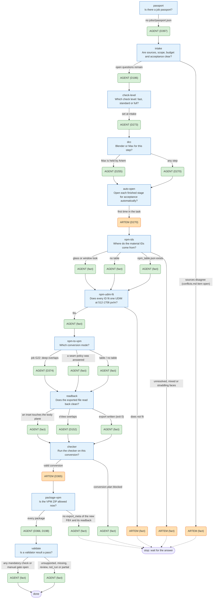

# Decision tree: `npm-to-vpm`

Generated from [`decision-trees.json`](../decision-trees.json) by `python tools/architecture/decision_trees.py --render` (#2039); do not edit by hand.
Trail: `docs/scenarios/npm-to-vpm.md`. Stages: `skeletons.json` cell `npm-to-vpm`. AGENT = the agent decides by the quoted rule; ARTEM = Artem decides on a picture sheet; gap = no shared step - manual.

| # | Stage | Question | Branch | Decider | Rule | Next |
|---|---|---|---|---|---|---|
| 1 | `passport` (entry) | Is there a job passport? | no jobs/<ID>/passport.json -> write the passport before any stage | AGENT | [D397]: «`jobs/<ID>/passport.json` (K1) is mandatory for every task» | intake |
| 2 | `intake` (entry) | Are sources, scope, budget and acceptance clear? | open questions remain -> ask ONE batch of <= 5 questions with recommendations | AGENT | [D186]: «ONE batch of <= 5 questions with recommendations» | check-level |
|  |  |  | sources disagree (conflicts.md item open) -> ask, never pick a side | ARTEM (sheet: both sources side by side with the place of the conflict) | `AGENTS.md`: «Where sources disagree (`docs/domain/conflicts.md`), ask the user; never pick a side silently.» | stop |
| 3 | `check-level` (entry) | Which check level: fast, standard or full? | set at intake -> agent sets it; may raise it with a reason, never lower it alone | AGENT | [D273]: «orchestrator/agent sets at intake, Artem overrides with one word» | dcc |
| 4 | `dcc` (entry) | Blender or Max for this step? | any step -> choose per step and state a one-line reason | AGENT | [D270]: «The agent chooses DCC per step from the known toolset/context and states a one-line reason» | auto-open |
|  |  |  | Max is held by Artem -> use an agent-owned Blender on a hashed copy | AGENT | [D255]: «Whenever 3ds Max is held by Artem, any modelling or check step that would use Max may run in an agent-owned Blender» | auto-open |
| 5 | `auto-open` (entry) | Open each finished stage for acceptance automatically? | first time in the task -> ask once; yes = open the new version + path, no = path only | ARTEM (sheet: one-line question in the intake batch) | [D270]: «Ask once per task whether to auto-open each completed stage» | npm-ids |
| 6 | `npm-ids` | Where do the material IDs come from? | npm_table.json exists -> validate it, table mode | AGENT | `docs/scenarios/npm-to-vpm.md`: «With table: validate it, use `npm.to_vpm` table mode» | npm-udim-fit |
|  |  |  | no table -> recover provisional IDs from atlas cells (not library approval) | AGENT | `docs/agents/SKELETONS-stages.md`: «IDs from atlas cells are provisional layout labels, **not** library-material approval» | npm-udim-fit |
|  |  |  | unresolved, mixed or straddling faces -> list with indices, ID0, conversion blocked | ARTEM (sheet: numbered atlas/model sheet of the unresolved faces) | `docs/agents/SKELETONS-stages.md`: «Unresolved/mixed/straddling faces are listed with source indices and remain ID0; they block conversion.» | stop |
|  |  |  | glass or window look -> never infer from colour | AGENT | `docs/scenarios/npm-to-vpm.md`: «Never infer glass/window semantics from colour» | npm-udim-fit |
| 7 | `npm-udim-fit` | Does every ID fit one UDIM at 512-1706 px/m? | fits -> continue to conversion | AGENT | `docs/agents/SKELETONS-stages.md`: «world metres, 4096 tile, 512-1706 px/m» | npm-to-vpm |
|  |  |  | does not fit -> stop before writes; one grouped question | ARTEM (sheet: per-ID fit table + options: seam cuts / extra tiles / allowed density) | `docs/agents/SKELETONS-stages.md`: «ask one grouped question with seam cuts / extra tiles / allowed density / other» | stop |
| 8 | `npm-to-vpm` | Which conversion mode? | table / no table -> table mode / regions mode | AGENT | `docs/agents/SKELETONS-stages.md`: «`regions` without table, `table` with `npm_table.json`» | readback |
|  |  |  | a seam policy was answered -> still no deleting or cropping unassigned faces | AGENT | `docs/scenarios/npm-to-vpm.md`: «An answered seam policy is not authority to ignore unassigned faces, crop mixed materials or delete faces.» | readback |
|  |  |  | job G22: deep overlaps -> keep the exterior finish, trim the neighbour up to 275 mm on a copy | AGENT | [D374]: «preserve the confirmed exterior facade finish» (job-local: `jobs/G22`) | readback |
| 9 | `readback` | Does the exported file read back clean? | export written (exit 0) -> read back topology, UV, materials, transforms | AGENT | `AGENTS.md`: «A successful import or exit code 0 is not a finished model» | checker |
|  |  |  | xView overlaps -> must be 0 at 2 mm / 5 mm | AGENT | [D152]: «Overlapping Vertices at 0.002 m = 0 and Overlapping Faces at 0.005 m = 0» | checker |
|  |  |  | an inset touches the body plane -> offset/embed, never weld | AGENT | `docs/agents/SKELETONS-stages.md`: «never by welding» | checker |
| 10 | `checker` | Run the checker on this conversion? | conversion plan blocked -> no checker and no package | AGENT | `docs/agents/SKELETONS-stages.md`: «no checker/package on a blocked conversion plan» | stop |
|  |  |  | valid conversion -> agr checker; fix findings only when Artem asks | ARTEM (sheet: checker summary: codes, counts, recommended fixes) | [D365]: «we fix SINTEZ findings ONLY when Artem asks, never automatically» | package-vpm |
| 11 | `package-vpm` | Is the VPM ZIP allowed now? | no export_meta of the new FBX and its readback -> stop before the ZIP | AGENT | `docs/agents/SKELETONS-stages.md`: «STOP до ZIP без `export_meta` нового FBX и его readback» | stop |
|  |  |  | every package -> a quad work FBX next to the ZIP | AGENT | [D366, D198]: «Work FBX with quads is made for EVERY package type» | validate |
| 12 | `validate` | Is a validator result a pass? | unsupported, missing, review, not_run or partial -> not a pass; report it | AGENT | `routes/npm-oks.md`: «Unsupported, missing, review, not_run and partial results are not passes» | done |
|  |  |  | any mandatory check or manual gate open -> passed=true forbidden | AGENT | `AGENTS.md`: «`passed=true` is forbidden while any mandatory check or manual gate is open.» | done |
