# Decision tree: `oks-npm`

Generated from [`decision-trees.json`](../decision-trees.json) by `python tools/architecture/decision_trees.py --render` (#2039); do not edit by hand.
Trail: `routes/npm-oks.md`. Stages: `skeletons.json` cell `oks-npm`. AGENT = the agent decides by the quoted rule; ARTEM = Artem decides on a picture sheet; gap = no shared step - manual.

```mermaid
flowchart TD
  N0["passport<br/>Is there a job passport?"]
  class N0 stage
  N1["intake<br/>Are sources, scope, budget and acceptance clear?"]
  class N1 stage
  N2["check-level<br/>Which check level: fast, standard or full?"]
  class N2 stage
  N3["dcc<br/>Blender or Max for this step?"]
  class N3 stage
  N4["auto-open<br/>Open each finished stage for acceptance automatically?"]
  class N4 stage
  N5["scene-prepare<br/>How is the Revit FBX split into layers (step 0)?"]
  class N5 stage
  N6["master-branch<br/>VPM+NPM or NPM-only: is there a mid-poly master?"]
  class N6 stage
  N7["modelling-plan<br/>Is the step-3 modelling plan accepted?"]
  class N7 stage
  N8["inspect<br/>Is the PartsList confirmed (Gate 1) and the budget allocated?"]
  class N8 stage
  N9["body<br/>How is each part built: lattice body, inset or texture?"]
  class N9 stage
  N10["mesh-quality<br/>Does a bad mesh-quality score return the work?"]
  class N10 stage
  N11["brick-seams<br/>Do the approved sources call for brick seams?"]
  class N11 stage
  N12["derive-npm<br/>Which atlas path and how are alpha, glass and budget handled?"]
  class N12 stage
  N13["master-qa<br/>Does the master pass topology before export?"]
  class N13 stage
  N14["readback<br/>Does the exported file read back clean?"]
  class N14 stage
  N15["verifier<br/>Does the VLM verifier change the model?"]
  class N15 stage
  N16["build-manifest<br/>Is the export bound to one master revision?"]
  class N16 stage
  N17["package-npm<br/>What goes with the NPM ZIP and which delivery data are known?"]
  class N17 stage
  N18["validate<br/>Is a validator result a pass?"]
  class N18 stage
  N19["review-scene<br/>Is the model visually accepted?"]
  class N19 stage
  N20["checker<br/>What happens with SINTEZ findings?"]
  class N20 stage
  N0 -->|"no jobs/<ID>/passport.json"| N0B0("AGENT (D397)")
  class N0B0 agent
  N0B0 --> N1
  N1 -->|"open questions remain"| N1B0("AGENT (D186)")
  class N1B0 agent
  N1B0 --> N2
  N1 -->|"sources disagree (conflicts.md item open)"| N1B1("ARTEM (fact)")
  class N1B1 artem
  N1B1 -.-> STOP
  N2 -->|"set at intake"| N2B0("AGENT (D273)")
  class N2B0 agent
  N2B0 --> N3
  N3 -->|"any step"| N3B0("AGENT (D270)")
  class N3B0 agent
  N3B0 --> N4
  N3 -->|"Max is held by Artem"| N3B1("AGENT (D255)")
  class N3B1 agent
  N3B1 --> N4
  N4 -->|"first time in the task"| N4B0("ARTEM (D270)")
  class N4B0 artem
  N4B0 --> N5
  N5 -->|"object placed with confidence by the rules file"| N5B0("AGENT (D390)")
  class N5B0 agent
  N5B0 --> N6
  N5 -->|"object not placed with confidence"| N5B1("ARTEM (D390)")
  class N5B1 artem
  N5B1 --> N6
  N5 -->|"proposed split ready"| N5B2("ARTEM (D390)")
  class N5B2 artem
  N5B2 -.-> STOP
  N5 -->|"split accepted"| N5B3("AGENT (D390)")
  class N5B3 agent
  N5B3 --> N6
  N6 -->|"deliverable VPM+NPM"| N6B0("AGENT (D292, D010)")
  class N6B0 agent
  N6B0 --> N7
  N6 -->|"deliverable NPM only"| N6B1("AGENT (D292)")
  class N6B1 agent
  N6B1 --> N7
  N7 -->|"plan sheet prepared from the accepted split"| N7B0("ARTEM (fact)")
  class N7B0 artem
  N7B0 -.-> STOP
  N7 -->|"job Sokolniki"| N7B1("AGENT (D407)")
  class N7B1 agent
  N7B1 --> N8
  N7 -->|"job Sokolniki: finish of a facade zone"| N7B2("AGENT (D413)")
  class N7B2 agent
  N7B2 --> N8
  N8 -->|"PartsList drafted"| N8B0("ARTEM (D125)")
  class N8B0 artem
  N8B0 -.-> STOP
  N8 -->|"triangle budget per part"| N8B1("AGENT (D276)")
  class N8B1 agent
  N8B1 --> N9
  N8 -->|"a fact is missing (dimension, finish, level)"| N8B2("ARTEM (fact)")
  class N8B2 artem
  N8B2 -.-> STOP
  N9 -->|"body with openings"| N9B0("AGENT (D373, D392)")
  class N9B0 agent
  N9B0 --> N10
  N9 -->|"a mesh defect is found"| N9B1("AGENT (D373)")
  class N9B1 agent
  N9B1 -.-> STOP
  N9 -->|"a facade line is shorter than 1.5 m of class change"| N9B2("AGENT (D373)")
  class N9B2 agent
  N9B2 --> N10
  N9 -->|"windows, stained glass, roof, flashings, posts"| N9B3("AGENT (D336)")
  class N9B3 agent
  N9B3 --> N10
  N9 -->|"panels / cassettes"| N9B4("AGENT (D336)")
  class N9B4 agent
  N9B4 --> N10
  N9 -->|"plinth"| N9B5("AGENT (D336)")
  class N9B5 agent
  N9B5 --> N10
  N9 -->|"window opening"| N9B6("AGENT (D292)")
  class N9B6 agent
  N9B6 --> N10
  N9 -->|"roof inside a parapet"| N9B7("AGENT (D292)")
  class N9B7 agent
  N9B7 --> N10
  N9 -->|"decor and attachments"| N9B8("AGENT (D199)")
  class N9B8 agent
  N9B8 --> N10
  N9 -->|"finish of a face is not in the sources"| N9B9("ARTEM (fact)")
  class N9B9 artem
  N9B9 -.-> STOP
  N9 -->|"job Sokolniki: windows, doors, curtain walls"| N9B10("AGENT (D417, D418)")
  class N9B10 agent
  N9B10 --> N10
  N10 -->|"any score"| N10B0("AGENT (fact)")
  class N10B0 agent
  N10B0 --> N11
  N10 -->|"a threshold or return mode is wanted"| N10B1("ARTEM (fact)")
  class N10B1 artem
  N10B1 --> N11
  N11 -->|"yes, with module/phase/width"| N11B0("AGENT (fact)")
  class N11B0 agent
  N11B0 --> N12
  N11 -->|"no / cassettes"| N11B1("AGENT (fact)")
  class N11B1 agent
  N11B1 --> N12
  N12 -->|"atlas path"| N12B0("AGENT (D292)")
  class N12B0 agent
  N12B0 --> N13
  N12 -->|"transparency needed"| N12B1("AGENT (D020)")
  class N12B1 agent
  N12B1 --> N13
  N12 -->|"over the triangle budget"| N12B2("AGENT (fact)")
  class N12B2 agent
  N12B2 --> N13
  N13 -->|"an n-gon (> 4 sides)"| N13B0("AGENT (D312)")
  class N13B0 agent
  N13B0 -.-> STOP
  N13 -->|"unavoidable triangles"| N13B1("AGENT (D312)")
  class N13B1 agent
  N13B1 --> N14
  N13 -->|"inset elements"| N13B2("AGENT (D336)")
  class N13B2 agent
  N13B2 --> N14
  N14 -->|"export written (exit 0)"| N14B0("AGENT (fact)")
  class N14B0 agent
  N14B0 --> N15
  N14 -->|"xView overlaps"| N14B1("AGENT (D152)")
  class N14B1 agent
  N14B1 --> N15
  N14 -->|"an inset touches the body plane"| N14B2("AGENT (fact)")
  class N14B2 agent
  N14B2 --> N15
  N15 -->|"default"| N15B0("AGENT (fact)")
  class N15B0 agent
  N15B0 --> N16
  N15 -->|"fix mode wanted"| N15B1("ARTEM (fact)")
  class N15B1 artem
  N15B1 --> N16
  N16 -->|"two master revisions or changed hashes"| N16B0("AGENT (fact)")
  class N16B0 agent
  N16B0 -.-> STOP
  N16 -->|"package with several parts"| N16B1("AGENT (D328)")
  class N16B1 agent
  N16B1 --> N17
  N17 -->|"every package"| N17B0("AGENT (D366, D198)")
  class N17B0 agent
  N17B0 --> N18
  N17 -->|"address / district code / coordinates unknown"| N17B1("AGENT (fact)")
  class N17B1 agent
  N17B1 --> N18
  N17 -->|"FNO code missing"| N17B2("AGENT (D220)")
  class N17B2 agent
  N17B2 --> N18
  N18 -->|"unsupported, missing, review, not_run or partial"| N18B0("AGENT (fact)")
  class N18B0 agent
  N18B0 --> N19
  N18 -->|"any mandatory check or manual gate open"| N18B1("AGENT (fact)")
  class N18B1 agent
  N18B1 --> N19
  N19 -->|"Max is held by Artem"| N19B0("AGENT (D255)")
  class N19B0 agent
  N19B0 --> N20
  N19 -->|"review copy ready"| N19B1("ARTEM (D104, D125)")
  class N19B1 artem
  N19B1 -.-> STOP
  N20 -->|"order of checks"| N20B0("AGENT (D352)")
  class N20B0 agent
  N20B0 --> DONE
  N20 -->|"findings"| N20B1("ARTEM (D365)")
  class N20B1 artem
  N20B1 -.-> STOP
  N20 -->|"final check closed"| N20B2("AGENT (D300)")
  class N20B2 agent
  N20B2 --> DONE
  STOP(["stop: wait for the answer"])
  DONE(["done"])
  classDef agent fill:#d8f0d8,stroke:#2e7d32
  classDef artem fill:#ffe0b2,stroke:#e65100
  classDef gap fill:#eeeeee,stroke:#616161,stroke-dasharray:4
  classDef stage fill:#e3f2fd,stroke:#1565c0
```

| # | Stage | Question | Branch | Decider | Rule | Next |
|---|---|---|---|---|---|---|
| 1 | `passport` (entry) | Is there a job passport? | no jobs/<ID>/passport.json -> write the passport before any stage | AGENT | [D397]: «`jobs/<ID>/passport.json` (K1) is mandatory for every task» | intake |
| 2 | `intake` (entry) | Are sources, scope, budget and acceptance clear? | open questions remain -> ask ONE batch of <= 5 questions with recommendations | AGENT | [D186]: «ONE batch of <= 5 questions with recommendations» | check-level |
|  |  |  | sources disagree (conflicts.md item open) -> ask, never pick a side | ARTEM (sheet: both sources side by side with the place of the conflict) | `AGENTS.md`: «Where sources disagree (`docs/domain/conflicts.md`), ask the user; never pick a side silently.» | stop |
| 3 | `check-level` (entry) | Which check level: fast, standard or full? | set at intake -> agent sets it; may raise it with a reason, never lower it alone | AGENT | [D273]: «orchestrator/agent sets at intake, Artem overrides with one word» | dcc |
| 4 | `dcc` (entry) | Blender or Max for this step? | any step -> choose per step and state a one-line reason | AGENT | [D270]: «The agent chooses DCC per step from the known toolset/context and states a one-line reason» | auto-open |
|  |  |  | Max is held by Artem -> use an agent-owned Blender on a hashed copy | AGENT | [D255]: «Whenever 3ds Max is held by Artem, any modelling or check step that would use Max may run in an agent-owned Blender» | auto-open |
| 5 | `auto-open` (entry) | Open each finished stage for acceptance automatically? | first time in the task -> ask once; yes = open the new version + path, no = path only | ARTEM (sheet: one-line question in the intake batch) | [D270]: «Ask once per task whether to auto-open each completed stage» | scene-prepare |
| 6 | `scene-prepare` (pre) | How is the Revit FBX split into layers (step 0)? | object placed with confidence by the rules file -> propose its layer | AGENT | [D390]: «by Revit family/material/position rules kept in one data file» | master-branch |
|  |  |  | object not placed with confidence -> 00_РЕШИТЬ_ЧЕЛОВЕКУ, never guessed | ARTEM (sheet: split sheet.png with the 00 group) | [D390]: «objects it cannot place with confidence go to 00_РЕШИТЬ_ЧЕЛОВЕКУ, never guessed» | master-branch |
|  |  |  | proposed split ready -> Artem corrects in Max and saves <job>_split_ACCEPTED | ARTEM (sheet: census.md + sheet.png + split_PROPOSED.fbx) | [D390]: «Artem corrects the split in 3ds Max and saves» | stop |
|  |  |  | split accepted -> the accepted file is the geometry source; never re-split | AGENT | [D390]: «that accepted file is the source of truth, the agent never re-splits after acceptance» | master-branch |
| 7 | `master-branch` (pre) | VPM+NPM or NPM-only: is there a mid-poly master? | deliverable VPM+NPM -> build the VPM / mid-poly master and derive NPM | AGENT | [D292, D010]: «VPM+NPM -> build the VPM or a mid-poly master and derive NPM from it» | modelling-plan |
|  |  |  | deliverable NPM only -> build NPM directly | AGENT | [D292]: «NPM-only -> build NPM directly, no mid-poly master» | modelling-plan |
| 8 | `modelling-plan` (pre) | Is the step-3 modelling plan accepted? | plan sheet prepared from the accepted split -> picture acceptance before modelling | ARTEM (sheet: modelling_plan.png: geometry / insets / texture / not shown, budget) | `routes/npm-oks.md`: «obtain picture acceptance before modelling» | stop |
|  |  |  | job Sokolniki -> accepted plan: ~40k tris, curtain-wall mullions as texture | AGENT | [D407]: «curtain-wall mullions (1092 + 1519) as texture» (job-local: `jobs/sokolniki-uvk1000`) | inspect |
|  |  |  | job Sokolniki: finish of a facade zone -> accepted material zoning, 14 finish IDs | AGENT | [D413]: «the material zoning and the NPM atlas layout of sheet v002 (14 finish IDs» (job-local: `jobs/sokolniki-uvk1000`) | inspect |
| 9 | `inspect` | Is the PartsList confirmed (Gate 1) and the budget allocated? | PartsList drafted -> Artem confirms the exact parts hash before construction | ARTEM (sheet: Gate 1 sheet: album, accepted source, proposed assembly, budget, parts hash) | [D125]: «Two human gates: the parts list before the build and one acceptance sheet after it» | stop |
|  |  |  | triangle budget per part -> allocate inside the project target, not the regulatory ceiling | AGENT | [D276]: «PartsList.triangle_budget is the allocated project budget for NPM/VPM, not the regulatory ceiling» | body |
|  |  |  | a fact is missing (dimension, finish, level) -> stop the dependent step; never guess thickness, joint module or georeference | ARTEM (sheet: the place on the source with the missing fact and a recommendation) | `routes/npm-oks.md`: «Missing facts/conflicts stop the dependent step; no generic shell thickness, joint module or georeference is guessed.» | stop |
| 10 | `body` | How is each part built: lattice body, inset or texture? | body with openings -> agr body from the lattice only | AGENT | [D373, D392]: «Stage-1 body is built ONLY from the lattice» | mesh-quality |
|  |  |  | a mesh defect is found -> fix the plan/input and rebuild, never repair the mesh | AGENT | [D373]: «repairing an existing mesh is forbidden, fix the input and rebuild» | stop |
|  |  |  | a facade line is shorter than 1.5 m of class change -> texture, not a mesh line | AGENT | [D373]: «a line is kept only if the cell class changes along it over >= 1.5 m or the opening width, shorter = texture» | mesh-quality |
|  |  |  | windows, stained glass, roof, flashings, posts -> inset elements cut into the body, never welded | AGENT | [D336]: «windows, stained glass (витражи) and similar fills, the roof, the flashings (отливы) on roofs and windows and the posts (стойки) are INSET» | mesh-quality |
|  |  |  | panels / cassettes -> texture with a seam in UV | AGENT | [D336]: «panels are shown by the TEXTURE with a seam (шов) in the texture/UV, not modelled» | mesh-quality |
|  |  |  | plinth -> one with the body or inset, per project; write the Modelling split line | AGENT | [D336]: «the agent decides per project and writes one line» | mesh-quality |
|  |  |  | window opening -> library window with a small inset if one fits, else the window generator | AGENT | [D292]: «a library window that fits the opening goes in with a small outline inset into the opening; if none fits, the window generator» | mesh-quality |
|  |  |  | roof inside a parapet -> cut the roof outline into the parapet walls, raised a few mm | AGENT | [D292]: «the walkable roof surface is cut in with its outline into the parapet walls» | mesh-quality |
|  |  |  | decor and attachments -> embed 10-20 mm into the facade | AGENT | [D199]: «decor and attachments (arches, light fixtures, frames and similar) embed 10-20 mm into their facade» | mesh-quality |
|  |  |  | finish of a face is not in the sources -> leave the material unknown and ask | ARTEM (sheet: the faces on the model next to the album sheet, a recommended finish) | `routes/npm-oks.md`: «Missing facts/conflicts stop the dependent step» | stop |
|  |  |  | job Sokolniki: windows, doors, curtain walls -> flat insets; frames, mullions and glazing drawn in the atlas | AGENT | [D417, D418]: «the NPM windows and doors are NOT geometry - frames, mullions / transoms, sashes, door leaves and their glazing pattern are drawn in the facade atlas texture» (job-local: `jobs/sokolniki-uvk1000`) | mesh-quality |
| 11 | `mesh-quality` | Does a bad mesh-quality score return the work? | any score -> record only, continue; one sheet line | AGENT | `docs/agents/SKELETONS-stages.md`: «`returns_work` is always `false`» | brick-seams |
|  |  |  | a threshold or return mode is wanted -> only after Artem's word on the week's numbers | ARTEM (sheet: weekly digest line of verifier_summary.py) | `docs/agents/SKELETONS-stages.md`: «Both change only after Artem's word on the week's numbers.» | brick-seams |
| 12 | `brick-seams` | Do the approved sources call for brick seams? | yes, with module/phase/width -> agr brick-seams candidate plan | AGENT | `routes/npm-oks.md`: «only if approved source calls for brick seams» | derive-npm |
|  |  |  | no / cassettes -> skip; never infer cassette cuts | AGENT | `routes/npm-oks.md`: «never infer cassette cuts» | derive-npm |
| 13 | `derive-npm` | Which atlas path and how are alpha, glass and budget handled? | atlas path -> path A (UDIM) or B (material IDs), one per task, stated in the report | AGENT | [D292] `routes/npm-oks.md`: «Pick one per task and state it in the job report.» | master-qa |
|  |  |  | transparency needed -> no alpha; separate _o_ opacity map | AGENT | [D020]: «no alpha in any NPM image; opacity as a separate `_o_` map» | master-qa |
|  |  |  | over the triangle budget -> follow the vpm-to-npm budget ladder | AGENT | `docs/agents/SKELETONS.md`: «бюджет треугольников ОКС — по лестнице бюджета ячейки `vpm-to-npm`» | master-qa |
| 14 | `master-qa` | Does the master pass topology before export? | an n-gon (> 4 sides) -> fail before export; fix the input and rebuild | AGENT | [D312]: «any n-gon (>4 sides) fails the master check» | stop |
|  |  |  | unavoidable triangles -> allowed, reported per object | AGENT | [D312]: «Triangles are allowed where unavoidable and must be reported per object» | readback |
|  |  |  | inset elements -> judged per element, never welded to pass | AGENT | [D336]: «quads are judged per element» | readback |
| 15 | `readback` | Does the exported file read back clean? | export written (exit 0) -> read back topology, UV, materials, transforms | AGENT | `AGENTS.md`: «A successful import or exit code 0 is not a finished model» | verifier |
|  |  |  | xView overlaps -> must be 0 at 2 mm / 5 mm | AGENT | [D152]: «Overlapping Vertices at 0.002 m = 0 and Overlapping Faces at 0.005 m = 0» | verifier |
|  |  |  | an inset touches the body plane -> offset/embed, never weld | AGENT | `docs/agents/SKELETONS-stages.md`: «never by welding» | verifier |
| 16 | `verifier` | Does the VLM verifier change the model? | default -> observe only, write verifier.json; positions from geometry | AGENT | `docs/agents/SKELETONS-stages.md`: «The VLM confirms; positions and counts come from geometry and drawing vectors» | build-manifest |
|  |  |  | fix mode wanted -> only after Artem's word, at most 3 rounds | ARTEM (sheet: verifier findings with the main discrepancy) | `docs/agents/SKELETONS-stages.md`: «only after Artem's word; at most 3 rounds» | build-manifest |
| 17 | `build-manifest` | Is the export bound to one master revision? | two master revisions or changed hashes -> V001 refuses; rebuild from one master | AGENT | `routes/npm-oks.md`: «refuses two master revisions» | stop |
|  |  |  | package with several parts -> each part keeps its own master | AGENT | [D328]: «Each part of a delivery package keeps its own master» | package-npm |
| 18 | `package-npm` | What goes with the NPM ZIP and which delivery data are known? | every package -> a quad work FBX next to the ZIP | AGENT | [D366, D198]: «Work FBX with quads is made for EVERY package type» | validate |
|  |  |  | address / district code / coordinates unknown -> never invent them | AGENT | `routes/npm-oks.md`: «No district code/address/coordinates are invented» | validate |
|  |  |  | FNO code missing -> issued by SINTEZ after placement by the customer's DWG | AGENT | [D220]: «the FNO code is issued by SINTEZ once the object is placed by that DWG» | validate |
| 19 | `validate` | Is a validator result a pass? | unsupported, missing, review, not_run or partial -> not a pass; report it | AGENT | `routes/npm-oks.md`: «Unsupported, missing, review, not_run and partial results are not passes» | review-scene |
|  |  |  | any mandatory check or manual gate open -> passed=true forbidden | AGENT | `AGENTS.md`: «`passed=true` is forbidden while any mandatory check or manual gate is open.» | review-scene |
| 20 | `review-scene` | Is the model visually accepted? | Max is held by Artem -> open the review copy in Blender | AGENT | [D255]: «Whenever 3ds Max is held by Artem, any modelling or check step that would use Max may run in an agent-owned Blender» | checker |
|  |  |  | review copy ready -> Artem accepts geometry visually before the final SINTEZ | ARTEM (sheet: acceptance sheet: model over album facades, overlays, material ids vs legend) | [D104, D125]: «geometry is accepted by a person (visual and mathematical) first, SINTEZ last» | stop |
| 21 | `checker` | What happens with SINTEZ findings? | order of checks -> preliminary SINTEZ, Artem's acceptance, final SINTEZ on the same hashes | AGENT | [D352]: «preliminary SINTEZ → Artem's acceptance → final SINTEZ» | done |
|  |  |  | findings -> report; fix only when Artem asks (sintez-fix cell) | ARTEM (sheet: checker summary: codes, counts, recommended fixes) | [D365]: «we fix SINTEZ findings ONLY when Artem asks, never automatically» | stop |
|  |  |  | final check closed -> hand the package to Artem (archive or quad Max scene) | AGENT | [D300]: «The finished package goes to ARTEM» | done |
