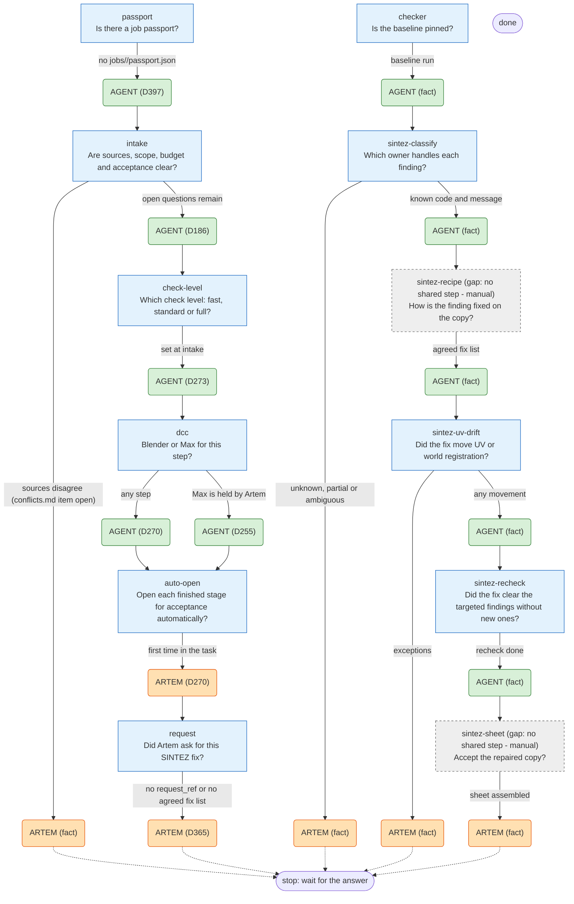

# Decision tree: `sintez-fix`

Generated from [`decision-trees.json`](../decision-trees.json) by `python tools/architecture/decision_trees.py --render` (#2039); do not edit by hand.
Trail: `docs/research/sintez-fix-1744.md`. Stages: `skeletons.json` cell `sintez-fix`. AGENT = the agent decides by the quoted rule; ARTEM = Artem decides on a picture sheet; gap = no shared step - manual.

| # | Stage | Question | Branch | Decider | Rule | Next |
|---|---|---|---|---|---|---|
| 1 | `passport` (entry) | Is there a job passport? | no jobs/<ID>/passport.json -> write the passport before any stage | AGENT | [D397]: «`jobs/<ID>/passport.json` (K1) is mandatory for every task» | intake |
| 2 | `intake` (entry) | Are sources, scope, budget and acceptance clear? | open questions remain -> ask ONE batch of <= 5 questions with recommendations | AGENT | [D186]: «ONE batch of <= 5 questions with recommendations» | check-level |
|  |  |  | sources disagree (conflicts.md item open) -> ask, never pick a side | ARTEM (sheet: both sources side by side with the place of the conflict) | `AGENTS.md`: «Where sources disagree (`docs/domain/conflicts.md`), ask the user; never pick a side silently.» | stop |
| 3 | `check-level` (entry) | Which check level: fast, standard or full? | set at intake -> agent sets it; may raise it with a reason, never lower it alone | AGENT | [D273]: «orchestrator/agent sets at intake, Artem overrides with one word» | dcc |
| 4 | `dcc` (entry) | Blender or Max for this step? | any step -> choose per step and state a one-line reason | AGENT | [D270]: «The agent chooses DCC per step from the known toolset/context and states a one-line reason» | auto-open |
|  |  |  | Max is held by Artem -> use an agent-owned Blender on a hashed copy | AGENT | [D255]: «Whenever 3ds Max is held by Artem, any modelling or check step that would use Max may run in an agent-owned Blender» | auto-open |
| 5 | `auto-open` (entry) | Open each finished stage for acceptance automatically? | first time in the task -> ask once; yes = open the new version + path, no = path only | ARTEM (sheet: one-line question in the intake batch) | [D270]: «Ask once per task whether to auto-open each completed stage» | request |
| 6 | `request` (pre) | Did Artem ask for this SINTEZ fix? | no request_ref or no agreed fix list -> do not start the cell | ARTEM (sheet: checker summary with the proposed fix list) | [D365] `docs/agents/SKELETONS-stages.md`: «Без ссылки `request_ref` на явное поручение и согласованного перечня правок не запускать ячейку» | stop |
| 7 | `checker` | Is the baseline pinned? | baseline run -> pin source ZIP, copy hashes and checker version | AGENT | `docs/agents/SKELETONS-stages.md`: «pin source ZIP, copy hashes and checker version» | sintez-classify |
| 8 | `sintez-classify` | Which owner handles each finding? | known code and message -> route by profile + requirement + message, not exit code | AGENT | `docs/agents/SKELETONS-stages.md`: «route by profile + requirement + underlying message, not by exit code» | sintez-recipe |
|  |  |  | unknown, partial or ambiguous -> stop the targeted repair | ARTEM (sheet: the rows with code, message and counts) | `docs/agents/SKELETONS-stages.md`: «Unknown/partial/ambiguous rows stop the targeted repair» | stop |
| 9 | `sintez-recipe` gap: no shared step - manual | How is the finding fixed on the copy? | agreed fix list -> one job hook or the owner (vpm-uv, master-qa, package); no generic auto-fix | AGENT | `docs/agents/SKELETONS-stages.md`: «No unattended generic fix.» | sintez-uv-drift |
| 10 | `sintez-uv-drift` | Did the fix move UV or world registration? | any movement -> report it, never round it away | AGENT | `docs/agents/SKELETONS-stages.md`: «Do not round away movement» | sintez-recheck |
|  |  |  | exceptions -> list them and stop for review | ARTEM (sheet: drift receipt with the exceptions) | `docs/agents/SKELETONS-stages.md`: «List exceptions and stop for explicit review» | stop |
| 11 | `sintez-recheck` | Did the fix clear the targeted findings without new ones? | recheck done -> compare targeted findings, coverage, new regressions | AGENT | `docs/agents/SKELETONS-stages.md`: «compare targeted findings, coverage and new regressions» | sintez-sheet |
| 12 | `sintez-sheet` gap: no shared step - manual | Accept the repaired copy? | sheet assembled -> Artem decides; no delivery or publication by the agent | ARTEM (sheet: before/after: hashes, codes, counts, UV/world movement, changed maps) | `docs/agents/SKELETONS-stages.md`: «No delivery or publication.» | stop |
