# Decision tree: `vpm-to-npm`

Generated from [`decision-trees.json`](../decision-trees.json) by `python tools/architecture/decision_trees.py --render` (#2039); do not edit by hand.
Trail: `docs/scenarios/vpm-to-npm.md`. Stages: `skeletons.json` cell `vpm-to-npm`. AGENT = the agent decides by the quoted rule; ARTEM = Artem decides on a picture sheet; gap = no shared step - manual.

```mermaid
flowchart TD
  N0["passport<br/>Is there a job passport?"]
  class N0 stage
  N1["intake<br/>Are sources, scope, budget and acceptance clear?"]
  class N1 stage
  N2["check-level<br/>Which check level: fast, standard or full?"]
  class N2 stage
  N3["dcc<br/>Blender or Max for this step?"]
  class N3 stage
  N4["auto-open<br/>Open each finished stage for acceptance automatically?"]
  class N4 stage
  N5["tris-count<br/>Is the VPM within the NPM triangle budget?"]
  class N5 stage
  N6["remove-interiors<br/>Which objects are interior?"]
  class N6 stage
  N7["atlas<br/>How is the NPM atlas built?"]
  class N7 stage
  N8["glass-merge<br/>How is glass mapped?"]
  class N8 stage
  N9["budget-ladder<br/>Still over budget: which simplification next?"]
  class N9 stage
  N10["master-qa<br/>Does the master pass topology before export?"]
  class N10 stage
  N11["readback<br/>Does the exported file read back clean?"]
  class N11 stage
  N12["verifier<br/>Does the VLM verifier change the model?"]
  class N12 stage
  N13["package-npm<br/>What goes with the NPM ZIP and which delivery data are known?"]
  class N13 stage
  N14["validate<br/>Is a validator result a pass?"]
  class N14 stage
  N15["checker<br/>What happens with SINTEZ findings?"]
  class N15 stage
  N16["review-scene<br/>Is the model visually accepted?"]
  class N16 stage
  N0 -->|"no jobs/<ID>/passport.json"| N0B0("AGENT (D397)")
  class N0B0 agent
  N0B0 --> N1
  N1 -->|"open questions remain"| N1B0("AGENT (D186)")
  class N1B0 agent
  N1B0 --> N2
  N1 -->|"sources disagree (conflicts.md item open)"| N1B1("ARTEM (fact)")
  class N1B1 artem
  N1B1 -.-> STOP
  N2 -->|"set at intake"| N2B0("AGENT (D273)")
  class N2B0 agent
  N2B0 --> N3
  N3 -->|"any step"| N3B0("AGENT (D270)")
  class N3B0 agent
  N3B0 --> N4
  N3 -->|"Max is held by Artem"| N3B1("AGENT (D255)")
  class N3B1 agent
  N3B1 --> N4
  N4 -->|"first time in the task"| N4B0("ARTEM (D270)")
  class N4B0 artem
  N4B0 --> N5
  N5 -->|"count first"| N5B0("AGENT (fact)")
  class N5B0 agent
  N5B0 --> N6
  N5 -->|"body looks heavy"| N5B1("AGENT (fact)")
  class N5B1 agent
  N5B1 --> N6
  N6 -->|"always"| N6B0("AGENT (fact)")
  class N6B0 agent
  N6B0 --> N7
  N6 -->|"the list"| N6B1("ARTEM (fact)")
  class N6B1 artem
  N6B1 -.-> STOP
  N7 -->|"all geometry"| N7B0("AGENT (fact)")
  class N7B0 agent
  N7B0 --> N8
  N7 -->|"transparency"| N7B1("AGENT (D020)")
  class N7B1 agent
  N7B1 --> N8
  N8 -->|"glass objects"| N8B0("AGENT (fact)")
  class N8B0 agent
  N8B0 --> N9
  N9 -->|"over budget"| N9B0("AGENT (fact)")
  class N9B0 agent
  N9B0 --> N10
  N9 -->|"a needed step has no hook"| N9B1("AGENT (fact)")
  class N9B1 agent
  N9B1 -.-> STOP
  N9 -->|"over budget after the whole ladder"| N9B2("ARTEM")
  class N9B2 artem
  N9B2 -.-> STOP
  N10 -->|"an n-gon (> 4 sides)"| N10B0("AGENT (D312)")
  class N10B0 agent
  N10B0 -.-> STOP
  N10 -->|"unavoidable triangles"| N10B1("AGENT (D312)")
  class N10B1 agent
  N10B1 --> N11
  N10 -->|"inset elements"| N10B2("AGENT (D336)")
  class N10B2 agent
  N10B2 --> N11
  N11 -->|"export written (exit 0)"| N11B0("AGENT (fact)")
  class N11B0 agent
  N11B0 --> N12
  N11 -->|"xView overlaps"| N11B1("AGENT (D152)")
  class N11B1 agent
  N11B1 --> N12
  N11 -->|"an inset touches the body plane"| N11B2("AGENT (fact)")
  class N11B2 agent
  N11B2 --> N12
  N12 -->|"default"| N12B0("AGENT (fact)")
  class N12B0 agent
  N12B0 --> N13
  N12 -->|"fix mode wanted"| N12B1("ARTEM (fact)")
  class N12B1 artem
  N12B1 --> N13
  N13 -->|"every package"| N13B0("AGENT (D366, D198)")
  class N13B0 agent
  N13B0 --> N14
  N13 -->|"address / district code / coordinates unknown"| N13B1("AGENT (fact)")
  class N13B1 agent
  N13B1 --> N14
  N13 -->|"FNO code missing"| N13B2("AGENT (D220)")
  class N13B2 agent
  N13B2 --> N14
  N14 -->|"unsupported, missing, review, not_run or partial"| N14B0("AGENT (fact)")
  class N14B0 agent
  N14B0 --> N15
  N14 -->|"any mandatory check or manual gate open"| N14B1("AGENT (fact)")
  class N14B1 agent
  N14B1 --> N15
  N15 -->|"order of checks"| N15B0("AGENT (D352)")
  class N15B0 agent
  N15B0 --> N16
  N15 -->|"findings"| N15B1("ARTEM (D365)")
  class N15B1 artem
  N15B1 -.-> STOP
  N15 -->|"final check closed"| N15B2("AGENT (D300)")
  class N15B2 agent
  N15B2 --> N16
  N16 -->|"Max is held by Artem"| N16B0("AGENT (D255)")
  class N16B0 agent
  N16B0 --> DONE
  N16 -->|"review copy ready"| N16B1("ARTEM (D104, D125)")
  class N16B1 artem
  N16B1 -.-> STOP
  STOP(["stop: wait for the answer"])
  DONE(["done"])
  classDef agent fill:#d8f0d8,stroke:#2e7d32
  classDef artem fill:#ffe0b2,stroke:#e65100
  classDef gap fill:#eeeeee,stroke:#616161,stroke-dasharray:4
  classDef stage fill:#e3f2fd,stroke:#1565c0
```

| # | Stage | Question | Branch | Decider | Rule | Next |
|---|---|---|---|---|---|---|
| 1 | `passport` (entry) | Is there a job passport? | no jobs/<ID>/passport.json -> write the passport before any stage | AGENT | [D397]: «`jobs/<ID>/passport.json` (K1) is mandatory for every task» | intake |
| 2 | `intake` (entry) | Are sources, scope, budget and acceptance clear? | open questions remain -> ask ONE batch of <= 5 questions with recommendations | AGENT | [D186]: «ONE batch of <= 5 questions with recommendations» | check-level |
|  |  |  | sources disagree (conflicts.md item open) -> ask, never pick a side | ARTEM (sheet: both sources side by side with the place of the conflict) | `AGENTS.md`: «Where sources disagree (`docs/domain/conflicts.md`), ask the user; never pick a side silently.» | stop |
| 3 | `check-level` (entry) | Which check level: fast, standard or full? | set at intake -> agent sets it; may raise it with a reason, never lower it alone | AGENT | [D273]: «orchestrator/agent sets at intake, Artem overrides with one word» | dcc |
| 4 | `dcc` (entry) | Blender or Max for this step? | any step -> choose per step and state a one-line reason | AGENT | [D270]: «The agent chooses DCC per step from the known toolset/context and states a one-line reason» | auto-open |
|  |  |  | Max is held by Artem -> use an agent-owned Blender on a hashed copy | AGENT | [D255]: «Whenever 3ds Max is held by Artem, any modelling or check step that would use Max may run in an agent-owned Blender» | auto-open |
| 5 | `auto-open` (entry) | Open each finished stage for acceptance automatically? | first time in the task -> ask once; yes = open the new version + path, no = path only | ARTEM (sheet: one-line question in the intake batch) | [D270]: «Ask once per task whether to auto-open each completed stage» | tris-count |
| 6 | `tris-count` | Is the VPM within the NPM triangle budget? | count first -> budget = standards NPM_STANDARD oks_triangles_per_fbx_max | AGENT | `docs/agents/SKELETONS-stages.md`: «Бюджет по умолчанию — `standards/NPM_STANDARD.yaml` `oks_triangles_per_fbx_max` (150000)» | remove-interiors |
|  |  |  | body looks heavy -> never rebuild or edit the body; no ProOptimizer | AGENT | `docs/scenarios/vpm-to-npm.md`: «Бадик не перестраивается и не правится, ProOptimizer не используется» | remove-interiors |
| 7 | `remove-interiors` | Which objects are interior? | always -> remove interiors | AGENT | `docs/scenarios/vpm-to-npm.md`: «Всегда удалить интерьеры» | atlas |
|  |  |  | the list -> explicit in config.interiors, shown on the Gate 1 sheet | ARTEM (sheet: Gate 1 sheet with the interior UDIMs/objects highlighted) | `docs/scenarios/vpm-to-npm.md`: «список задаётся явно в `config.interiors` и показывается на Gate 1 листом» | stop |
| 8 | `atlas` | How is the NPM atlas built? | all geometry -> on the atlas via agr vpm-to-npm | AGENT | `docs/scenarios/vpm-to-npm.md`: «Атлас НПМ, вся геометрия на атлас» | glass-merge |
|  |  |  | transparency -> separate opacity map, no alpha | AGENT | [D020]: «no alpha in any NPM image; opacity as a separate `_o_` map» | glass-merge |
| 9 | `glass-merge` | How is glass mapped? | glass objects -> one object, UV on pure white atlas pixels | AGENT | `docs/scenarios/vpm-to-npm.md`: «Стекло — одним объектом, его UV на чисто белых пикселях атласа» | budget-ladder |
| 10 | `budget-ladder` | Still over budget: which simplification next? | over budget -> cylinders -> opacity planes -> window planes, in order | AGENT | `docs/scenarios/vpm-to-npm.md`: «меньше сегментов у цилиндров → ограждения и кондиционеры одной плоскостью с opacity» | master-qa |
|  |  |  | a needed step has no hook -> report missing, not done (exit 1) | AGENT | `docs/agents/SKELETONS-stages.md`: «шаг лестницы, нужный при превышении, но не поданный хуком, — `missing`, а не «сделано»» | stop |
|  |  |  | over budget after the whole ladder -> ask for a decision | ARTEM (sheet: triangle table by group and 2-3 options with savings) | no rule | stop |
| 11 | `master-qa` | Does the master pass topology before export? | an n-gon (> 4 sides) -> fail before export; fix the input and rebuild | AGENT | [D312]: «any n-gon (>4 sides) fails the master check» | stop |
|  |  |  | unavoidable triangles -> allowed, reported per object | AGENT | [D312]: «Triangles are allowed where unavoidable and must be reported per object» | readback |
|  |  |  | inset elements -> judged per element, never welded to pass | AGENT | [D336]: «quads are judged per element» | readback |
| 12 | `readback` | Does the exported file read back clean? | export written (exit 0) -> read back topology, UV, materials, transforms | AGENT | `docs/agents/agents-reference.md`: «A successful import or exit code 0 is not a finished model» | verifier |
|  |  |  | xView overlaps -> must be 0 at 2 mm / 5 mm | AGENT | [D152]: «Overlapping Vertices at 0.002 m = 0 and Overlapping Faces at 0.005 m = 0» | verifier |
|  |  |  | an inset touches the body plane -> offset/embed, never weld | AGENT | `docs/agents/SKELETONS-stages.md`: «never by welding» | verifier |
| 13 | `verifier` | Does the VLM verifier change the model? | default -> observe only, write verifier.json; positions from geometry | AGENT | `docs/agents/SKELETONS-stages.md`: «The VLM confirms; positions and counts come from geometry and drawing vectors» | package-npm |
|  |  |  | fix mode wanted -> only after Artem's word, at most 3 rounds | ARTEM (sheet: verifier findings with the main discrepancy) | `docs/agents/SKELETONS-stages.md`: «only after Artem's word; at most 3 rounds» | package-npm |
| 14 | `package-npm` | What goes with the NPM ZIP and which delivery data are known? | every package -> a quad work FBX next to the ZIP | AGENT | [D366, D198]: «Work FBX with quads is made for EVERY package type» | validate |
|  |  |  | address / district code / coordinates unknown -> never invent them | AGENT | `routes/npm-oks.md`: «No district code/address/coordinates are invented» | validate |
|  |  |  | FNO code missing -> issued by SINTEZ after placement by the customer's DWG | AGENT | [D220]: «the FNO code is issued by SINTEZ once the object is placed by that DWG» | validate |
| 15 | `validate` | Is a validator result a pass? | unsupported, missing, review, not_run or partial -> not a pass; report it | AGENT | `routes/npm-oks.md`: «Unsupported, missing, review, not_run and partial results are not passes» | checker |
|  |  |  | any mandatory check or manual gate open -> passed=true forbidden | AGENT | `docs/agents/agents-reference.md`: «`passed=true` is forbidden while any mandatory check or manual gate is open.» | checker |
| 16 | `checker` | What happens with SINTEZ findings? | order of checks -> preliminary SINTEZ, Artem's acceptance, final SINTEZ on the same hashes | AGENT | [D352]: «preliminary SINTEZ → Artem's acceptance → final SINTEZ» | review-scene |
|  |  |  | findings -> report; fix only when Artem asks (sintez-fix cell) | ARTEM (sheet: checker summary: codes, counts, recommended fixes) | [D365]: «we fix SINTEZ findings ONLY when Artem asks, never automatically» | stop |
|  |  |  | final check closed -> hand the package to Artem (archive or quad Max scene) | AGENT | [D300]: «The finished package goes to ARTEM» | review-scene |
| 17 | `review-scene` | Is the model visually accepted? | Max is held by Artem -> open the review copy in Blender | AGENT | [D255]: «Whenever 3ds Max is held by Artem, any modelling or check step that would use Max may run in an agent-owned Blender» | done |
|  |  |  | review copy ready -> Artem accepts geometry visually before the final SINTEZ | ARTEM (sheet: acceptance sheet: model over album facades, overlays, material ids vs legend) | [D104, D125]: «geometry is accepted by a person (visual and mathematical) first, SINTEZ last» | stop |
