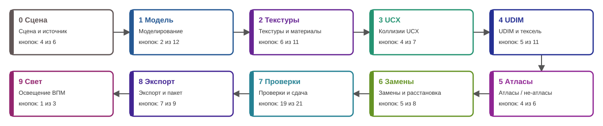

<!-- Generated by tools/max/build_agr_guide.py from docs/plans/agr-tools-suite.json; do not edit. -->
# AGR Tools 0.8.0: путь и кнопки

Это та же справка, что вкладка «Путь» в панели 3ds Max: обе собраны из одной таблицы `docs/plans/agr-tools-suite.json`.

Порядок работы: 0 Сцена → 1 Модель → 2 Текстуры → 3 UCX → 4 UDIM → 5 Атласы → 6 Замены → 7 Проверки → 8 Экспорт → 9 Свет.
В панели узел показывает состояние по последним отчётам сцены: ок, ошибки или не запускалось. Строка «Следующий шаг» называет первый блок с ошибками или без прогона.

Кнопки «в версии 0.x» ещё не сделаны; в панели они серые.

## 0 Сцена и источник

**Когда:** В начале работы со сценой, до любых правок: что за источник, какие единицы, чего не хватает.

Кнопок в этой версии: 3 из 4.

### Проверить и выделить — сцена не меняется

| Кнопка | Что делает | Режим | Требования | Есть |
|---|---|---|---|---|
| Перепись сцены (`scene.census`) | JSON: объекты, Multi/Sub, карты, пропавшие файлы, bbox, units, инстансы | только чтение | NPM-2.1-1.b VPM-2.1-1.c | да |
| Единицы и гамма (`scene.units`) | Проверяет System Unit = метры, 1 unit = 1 m, гамму 2.2/1.0; предлагает исправить | только чтение | NPM-1.2-1 VPM-1.2-1 | да |
| Пропавшие карты (`scene.missing_maps`) | Список битмапов с несуществующим путём и кандидаты для relink (без переименования файлов) | только чтение | NPM-2.1-1.b VPM-2.4-2 | да |
| Класс источника (`scene.source_class`) | Связные части, доля крупнейшей → оболочка / панели / сетка; до выбора маршрута | только чтение | - | в версии 1.0 |

## 1 Моделирование

**Когда:** Пока строится геометрия ОКС и Ground, до текстур и развёртки.

Кнопок в этой версии: 2 из 15.

### Проверить и выделить — сцена не меняется

| Кнопка | Что делает | Режим | Требования | Есть |
|---|---|---|---|---|
| Опуск периметра ≥1 м (`model.perimeter_drop`) | Проверяет, что полигоны по периметру ОКС/Ground опущены ниже ±0.000 не меньше чем на 1 м | только чтение | NPM-2.3-4 VPM-2.3-6 VPM-2.3-7.a | да |
| Выделить регион (`model.region_select`) | Растит выделение полигонов до замкнутого региона | только чтение, выделяет объекты | - | в версии 1.x |

### Исправить — копии / undo / новые файлы

| Кнопка | Что делает | Режим | Требования | Есть |
|---|---|---|---|---|
| Триангуляция (Делоне) (`model.triangulate`) | Триангулирует n-гоны на экспортной копии по Делоне, без длинных клиньев | правит только копии | NPM-2.3-11 VPM-2.3-17 | да |
| Стекло плоскостями (`model.glass_planes`) | Сводит стекло окна к одной плоскости без толщины, режет рамы и дубли | правит только копии | NPM-2.3-10 VPM-2.8-4 | в версии 1.0 |
| Граница Ground (`model.ground_border`) | Упрощает границу благоустройства и чинит веерную топологию | правит сцену, отмена через Undo | NPM-2.3-1.a VPM-2.3-3 | в версии 1.0 |
| Нарезка рельефа сеткой (`model.ground_slice`) | Режет Ground сеткой 2.5–7.6 м по мировым осям | правит только копии | NPM-2.6-1 | в версии 1.0 |
| Регулярная поверхность рельефа (`model.ground_surface`) | Заменяет триангулированную поверхность регулярной сеткой по высотам | правит только копии | NPM-2.6-1 NPM-2.3-1.a | в версии 1.0 |
| Раздвинуть задвойки (`model.move_apart`) | Раздвигает пары граней/вершин 0–2, 3–10, 10–20 мм до чистого xView | правит сцену, отмена через Undo | NPM-2.3-9 VPM-2.3-13 | в версии 1.0 |
| Повтор операций по фасаду (`model.poly_actions`) | Записывает extrude/inset/MatID/connect и повторяет на группах полигонов | правит сцену, отмена через Undo | - | в версии 1.0 |
| Сварка T-стыков (`model.tjunction_weld`) | Сваривает T-стыки окон и проёмов только в выделении, с порогом в метрах | правит сцену, отмена через Undo | NPM-2.3-7.b VPM-2.3-11.b | в версии 1.0 |
| Вогнутые полигоны (`model.concave_fix`) | Находит и режет вогнутые полигоны | правит сцену, отмена через Undo | NPM-2.3-11 | в версии 1.x |
| Детриангуляция (`model.detriangulate`) | Убирает диагонали триангуляции для правки в квадах | правит сцену, отмена через Undo | - | в версии 1.x |
| Интерьерная коробка (`model.interior_box`) | Заменяет интерьер сплошной коробкой со стенами ≥10 см | правит сцену, отмена через Undo | VPM-2.3-12.a VPM-2.3-12.b | в версии 1.x |
| Выравнивание по 3 точкам (`model.three_pt_align`) | Совмещает объект с другим по трём парам точек | правит сцену, отмена через Undo | - | в версии 1.x |
| Расстановка окон (`model.window_placer`) | Ставит окна по списку и привязывает к проёмам | правит сцену, отмена через Undo | NPM-2.3-10 | в версии 1.x |

## 2 Текстуры и материалы

**Когда:** Когда назначены материалы и текстуры, до развёртки и атласа.

Кнопок в этой версии: 4 из 11.

### Проверить и выделить — сцена не меняется

| Кнопка | Что делает | Режим | Требования | Есть |
|---|---|---|---|---|
| Текстуры (все объекты) (`tex.check`) | Размер, квадрат, заглушки, альфа, 8 бит/канал, размер файла, набор UDIM, паддинг | только чтение | NPM-2.5-1.a NPM-2.5-2.a NPM-2.5-3 NPM-2.5-4 NPM-2.5-5 VPM-2.5-1.2 VPM-2.5-1.5 VPM-2.5-1.6 VPM-2.5-1.9 | да |
| Тип материала (`tex.material_type`) | Только Standard/Physical; Corona/VRay и пр. — ошибка с именем материала | только чтение | NPM-2.4-1.a NPM-2.4-1.b VPM-2.4-1.a VPM-2.4-1.b | да |
| ERM и нормали DirectX (`tex.erm_normal_check`) | Проверяет каналы ERM (R только свечение) и ориентацию нормалей DirectX | только чтение | VPM-2.5-1.7 VPM-2.14-1 VPM-2.14-2 VPM-2.14-3 | в версии 0.9 |
| Браузер текстур (`tex.browser`) | Показывает карты объекта и их размеры (только чтение) | только чтение | VPM-2.4-2 | в версии 1.x |
| Цвет заглушки (`tex.plug_colour`) | Проверяет, что заглушка одного (среднего) цвета, показывает разброс | только чтение | VPM-2.5-3.4 | в версии 1.x |

### Исправить — копии / undo / новые файлы

| Кнопка | Что делает | Режим | Требования | Есть |
|---|---|---|---|---|
| Формат PNG: альфа, 24 бит, ≤3 МБ (`tex.format_fix`) | Пишет исправленные PNG в новую папку: без альфы, 24 бит, сжатие до лимита | пишет новые файлы, исходники не трогает | NPM-2.5-2.a NPM-2.5-3 NPM-2.5-5 VPM-2.5-1.6 VPM-2.5-1.9 | да |
| Заглушки 256 / 128 (`tex.placeholders`) | Создаёт однотонные заглушки Diffuse/ERM/Normal нужного размера и цвета | пишет новые файлы, исходники не трогает | VPM-2.5-3.1 VPM-2.5-3.3 VPM-2.5-3.4 NPM-2.5-7 | да |
| Покраска по легенде (`tex.finish_map`) | ID → отделка по листу цветового решения: легенда, кольца швов, проверка | правит только копии | NPM-2.4-4 VPM-2.4-1.a | в версии 0.9 |
| Отступы карт (dilate) (`tex.dilate`) | Раздувает цвет за край островов по маске альфы/UV, оригинал поверх | пишет новые файлы, исходники не трогает | NPM-2.5-4 VPM-2.5-1.5 | в версии 1.0 |
| Наборы ВПМ D+ERM+N (`tex.vpm_sets`) | Собирает Diffuse, ERM (R свечение, G шероховатость, B металл) и Normal на UDIM | пишет новые файлы, исходники не трогает | VPM-2.5-1.4.a VPM-2.11-0.h VPM-2.14-1 VPM-2.14-3 | в версии 1.0 |
| Мультиматериал из карт (`tex.multimat`) | Собирает Multi/Sub из найденных карт ВПМ по именам T_ | правит сцену, отмена через Undo | VPM-2.4-3.b VPM-2.4-5 | в версии 1.x |

## 3 Коллизии UCX

**Когда:** Для ВПМ, когда геометрия готова: коллизии строятся и проверяются до экспорта.

Кнопок в этой версии: 4 из 7.

### Проверить и выделить — сцена не меняется

| Кнопка | Что делает | Режим | Требования | Есть |
|---|---|---|---|---|
| UCX: аудит сцены (`ucx.audit`) | Готовые UCX: выпуклость, замкнутость, без материалов, имя, пересечения SAT, бюджет | только чтение | VPM-2.13-1.a VPM-2.13-1.b VPM-2.13-1.c VPM-2.13-1.d VPM-2.13-3 VPM-2.13-4.a VPM-2.13-7.a VPM-2.13-7.b | да |
| UCX лестниц (`ucx.stairs`) | Проверяет, что лестница закрыта усечённой пирамидой, и допуски 10/30/100 см | только чтение | VPM-2.13-5 VPM-2.13-6 | в версии 1.x |

### Исправить — копии / undo / новые файлы

| Кнопка | Что делает | Режим | Требования | Есть |
|---|---|---|---|---|
| UCX: построить (`ucx.build`) | Вариант по WHEN.md (single-hull, kernel-boxes, slice-prisms), бюджет D012, аудит, копии | правит только копии | VPM-2.13-1.a VPM-2.13-1.b VPM-2.13-7.a VPM-2.13-7.b | да |
| UCX: триангуляция (`ucx.triangulate`) | Триангулирует UCX на копии и проверяет выпуклость после | правит только копии | VPM-2.3-17 VPM-2.13-1.a | да |
| UCX: имена (`ucx.rename`) | Переименовывает куски в UCX_SM_<Address>_Main/Ground_NNN | правит сцену, отмена через Undo | VPM-2.13-1.d VPM-2.10-4.2.b | да |
| UCX: зазор 2 мм – 1 см (`ucx.gap`) | Сдвигает куски UCX внутрь по нормалям до зазора в полосе D098 | правит только копии | VPM-2.13-4.a VPM-2.13-4.b | в версии 1.0 |
| UCX рельефа (`ucx.ground`) | UCX Ground по верхним граням рельефа призмами по адаптивной сетке | правит только копии | VPM-2.13-3 VPM-2.13-7.b | в версии 1.0 |

## 4 UDIM и тексель

**Когда:** Когда развёртка готова: тексель и UDIM-тайлы до сборки атласа.

Кнопок в этой версии: 3 из 10.

### Проверить и выделить — сцена не меняется

| Кнопка | Что делает | Режим | Требования | Есть |
|---|---|---|---|---|
| Тексель px/м (`udim.texel`) | Мин/медиана px/м по мешу и материалу, полосы ВПМ 512–1706, НПМ 10–40 | только чтение | VPM-2.6-2 NPM-2.6-1 | да |
| UDIM: тайлы и слоты (`udim.slots`) | 1001… без пропусков, ≤100 карт на материал, SlotNumber 1…7 подряд | только чтение | VPM-2.4-3.a VPM-2.4-3.b VPM-2.5-2.1.3.a VPM-2.11-0.b | в версии 0.9 |
| Искажения UV (`udim.distortion`) | Подсвечивает растянутые полигоны UV | только чтение | VPM-2.6-2 | в версии 1.x |
| UDIM → ID (просмотр) (`udim.udims_to_ids`) | Показывает, какой тайл даёт какой ID, без записи | только чтение | VPM-2.5-2.1.3.a | в версии 1.x |
| Просмотр UDIM (`udim.viewer`) | Показывает тайлы UDIM на объекте и карты из папки | только чтение | - | в версии 1.x |

### Исправить — копии / undo / новые файлы

| Кнопка | Что делает | Режим | Требования | Есть |
|---|---|---|---|---|
| UV-сдвиг на целый тайл (`udim.nudge`) | Сдвигает острова на целое число периодов повтора (в фазе текстуры) | правит только копии | VPM-2.5-2.1.3.a | да |
| ID → UDIM на копии (`udim.ids_to_udims`) | Раскладывает материал ID n в тайл 1000+n на экспортной копии | правит только копии | VPM-2.5-2.1.3.a VPM-2.5-2.1.3.b | да |
| MatID → UDIM (МАФ) (`udim.matid_unwrap`) | Развёртка по MatID в тайлы с плотностью и упаковкой | правит только копии | VPM-2.6-2 VPM-2.5-2.1.3.a | в версии 0.9 |
| Подгонка плотности (`udim.rescale`) | Масштабирует UV до целевой плотности синхронно с текстурами | правит только копии | VPM-2.6-2 NPM-2.6-1 | в версии 1.0 |
| Развёртка плиток в UDIM (`udim.unwrap_tiles`) | Раскладывает плитки фасада по UDIM на копии | правит только копии | VPM-2.5-2.1.3.a | в версии 1.0 |

## 5 Атласы / не-атласы

**Когда:** Когда UDIM готовы: собрать атлас НПМ и проверить число наборов.

Кнопок в этой версии: 2 из 6.

### Проверить и выделить — сцена не меняется

| Кнопка | Что делает | Режим | Требования | Есть |
|---|---|---|---|---|
| Число текстурных наборов (`atlas.sets_count`) | ОКС ≤40 наборов (+1 кровля), Ground ≤20, GroundEl 1, Flora 1 | только чтение | NPM-2.1-4.c NPM-2.1-5.b NPM-2.5-11.a NPM-2.5-11.b | да |

### Исправить — копии / undo / новые файлы

| Кнопка | Что делает | Режим | Требования | Есть |
|---|---|---|---|---|
| UDIM → атлас НПМ (`atlas.npm`) | Сводит UDIM в один атлас НПМ, ремап UV на копии, отступ ≥8 px | правит только копии | NPM-2.5-4 NPM-2.5-11.a | да |
| Атлас Flora (`atlas.flora`) | Пакует диффуз и отдельную прозрачность Flora в один набор ≤2048, отступ ≥8 px | пишет новые файлы, исходники не трогает | NPM-2.5-13.a NPM-2.5-13.b NPM-2.5-4 | в версии 0.9 |
| Атлас GroundEl ≤512 (`atlas.groundel`) | Один набор элементов благоустройства, ≤512 px | правит только копии | NPM-2.5-12 NPM-2.1-5.b | в версии 0.9 |
| Фасадный атлас run-strip (`atlas.facade_strip`) | Атлас фасада полосами повторов для НПМ ОКС | правит только копии | NPM-2.5-11.a NPM-2.5-4 | в версии 1.0 |
| Атлас → мультиматериал (`atlas.unatlas`) | Обратный путь НПМ → ВПМ: атлас в Multi/Sub по ячейкам | правит только копии | VPM-2.4-3.a | в версии 1.x |

## 6 Замены и расстановка

**Когда:** Когда нужны МАФ, Flora и замены по ведомости: после модели, до проверок.

Кнопок в этой версии: 0 из 8.

### Проверить и выделить — сцена не меняется

| Кнопка | Что делает | Режим | Требования | Есть |
|---|---|---|---|---|
| Проверки МАФ (`place.maf_checks`) | Пересечения, висящие над рельефом (AABB не касается), масштаб, треугольники | только чтение | NPM-2.3-6.b NPM-2.5-12 | в версии 0.9 |

### Исправить — копии / undo / новые файлы

| Кнопка | Что делает | Режим | Требования | Есть |
|---|---|---|---|---|
| Flora: ремонт и проверка (`place.flora_repair`) | Чинит трансформы и треугольники Flora, проверяет набор | правит только копии | NPM-2.5-13.a NPM-2.3-14 | в версии 0.9 |
| Замена объектов (`place.replace`) | Заменяет объекты по маске имени на эталон с сохранением трансформа и имени | правит сцену, отмена через Undo | NPM-2.3-5 VPM-2.3-8 | в версии 0.9 |
| Расстановка по ведомости (`place.schedule`) | Ставит МАФ по ведомости/плану и пишет отчёт: поставлено / нет эталона / нет места | правит только копии | NPM-2.1-5.a | в версии 0.9 |
| Посадить на рельеф (`place.drop_to_ground`) | Опускает МАФ/деревья на поверхность Ground по лучу | правит сцену, отмена через Undo | - | в версии 0.9 |
| Генератор МАФ (`place.maf_generator`) | Параметрический МАФ по семейству (первое — скамьи «Верона») | правит только копии | NPM-2.5-12 | в версии 1.0 |
| Скаттер (`place.scatter`) | Рассыпает объекты по поверхности с плотностью и случайностью | правит сцену, отмена через Undo | - | в версии 1.x |
| Деревья спрайтами (`place.tree_cards`) | Дерево из плоскостей-карточек с ID ствола/веток | правит только копии | NPM-2.5-13.a VPM-2.3-16 | в версии 1.x |

## 7 Проверки и сдача

**Когда:** Перед сдачей: прочитать сцену и найти ошибки; сцена не меняется.

Кнопок в этой версии: 14 из 19.

### Проверить и выделить — сцена не меняется

| Кнопка | Что делает | Режим | Требования | Есть |
|---|---|---|---|---|
| MatID (`qa.matid`) | ID ≥1001, ID 0, пустые слоты Multi/Sub | только чтение, выделяет объекты | NPM-2.4-5 VPM-2.4-5 | да |
| xView: перекрытия (`qa.xview`) | Нативный xView: вершины 2 мм, грани 5 мм, на вычисленных копиях | только чтение, выделяет объекты | NPM-2.3-7.a NPM-2.3-9 VPM-2.3-11.a VPM-2.3-13 | да |
| Проверка GeoJSON (`qa.geojson`) | Проверка паспорта GeoJSON пилотным twinqa.geojson | только чтение | GJ-1 GJ-2 GJ-3 VPM-2.2-1 | да |
| Имена NPM/VPM (`qa.names`) | SM/UCX, M, T по маскам, SlotNumber 1…7 | только чтение | NPM-2.10-1 NPM-2.10-2 NPM-2.10-3.3.a VPM-2.10-2.a VPM-2.11-0.a VPM-2.11-0.c | да |
| Пивот (`qa.pivot`) | Z = 0 и один пивот на FBX (1 мм) | только чтение | VPM-2.9-4.b VPM-2.9-5 | да |
| Треугольники по FBX (`qa.tris`) | Лимиты на FBX: НПМ 150 000 / 180 000, ВПМ 1 000 000, Ground по площади, UCX | только чтение | NPM-2.3-6.a NPM-2.3-6.b VPM-2.3-9 VPM-2.3-10 | да |
| Разделение FBX (`qa.fbx_split`) | ОКС ≤20 FBX, ≤20 объектов на FBX, Ground обязателен, нумерация сквозная | только чтение | NPM-2.1-2 NPM-2.1-4.a NPM-2.1-6 NPM-2.2-1 NPM-2.2-4 VPM-2.1-3.a VPM-2.1-4 | да |
| Стекло (`qa.glass`) | MainGlass отдельно, ≤20 полупрозрачных, ≤7 материалов стекла, без текстур, 50 % | только чтение | NPM-2.7-2 NPM-2.1-4.b NPM-2.4-2 NPM-2.4-3.b NPM-2.4-6 VPM-2.8-1 VPM-2.8-2 VPM-2.3-4 | да |
| Предсдача: все проверки (`qa.preflight`) | Запускает все проверки профиля одним нажатием, одна таблица, ничего не меняет | только чтение | NPM-2.1-3.c VPM-2.3-1 | да |
| Лишнее в сцене (`qa.scene_hygiene`) | Камеры, кости, анимация, слои, группы/иерархия, пустые объекты, модификаторы | только чтение | NPM-2.1-3.a NPM-2.1-3.b NPM-2.1-3.c NPM-2.1-3.d NPM-2.3-5 VPM-2.3-1 VPM-2.3-2 VPM-2.3-8 VPM-2.3-11.d VPM-2.3-11.e | да |
| Трансформы сброшены (`qa.xform`) | Находит несброшенный масштаб/поворот/зеркало и родителей; сброс только на копии | только чтение | NPM-2.3-14 VPM-2.3-18 | да |
| Нулевые площади и рёбра (`qa.zero_area`) | Полигоны нулевой площади, рёбра нулевой длины, изолированные вершины | только чтение | NPM-2.3-7.b NPM-2.3-7.c VPM-2.3-11.b VPM-2.3-11.c | да |
| Проверка пакета ZIP (`qa.package`) | ZIP: размеры, состав FBX/PNG/GeoJSON, имена, битые файлы, readback | только чтение | NPM-2.1-1.a NPM-2.1-1.b VPM-2.1-1.a VPM-2.1-1.b VPM-2.1-2.a VPM-2.1-2.c VPM-2.1-2.d | да |
| Адрес и улицы (`qa.address`) | Проверка Address по справочнику улиц, составных частей и длины | только чтение | NPM-1.3-2.a NPM-1.3-3.a VPM-1.3-2.a VPM-1.3-3.a | в версии 0.9 |
| Сравнение с листом фасада (`qa.facade_compare`) | Картинка «лист / ВПМ / НПМ» в одном масштабе и счёт швов | только чтение | - | в версии 0.9 |
| Нормали и двойные грани (`qa.normals`) | Нормали к наблюдателю, двусторонние полигоны стекла/Flora, сглаживание | только чтение | NPM-2.3-8.a NPM-2.3-15 VPM-2.3-14 VPM-2.3-15.a VPM-2.12-3 | в версии 0.9 |
| Сверка с SINTEZ (`qa.sintez`) | Сравнивает наши находки с отчётом SINTEZ по тем же правилам | только чтение | VPM-2.3-17 | в версии 0.9 |
| Код ОМК ТЭ (`qa.omk_te`) | Поиск кода классификатора по таблице и вставка | только чтение | NPM-2.10-3.1 | в версии 1.x |

### Исправить — копии / undo / новые файлы

| Кнопка | Что делает | Режим | Требования | Есть |
|---|---|---|---|---|
| Исправить имена (`qa.names_fix`) | Переименовывает объекты, материалы и файлы карт по маске на экспортных копиях | правит только копии | NPM-2.10-3.3.a NPM-2.10-3.4.a VPM-2.11-0.a VPM-2.10-4.3 | да |

## 8 Экспорт и пакет

**Когда:** Когда проверки чистые: FBX с проверкой, пакет и архив.

Кнопок в этой версии: 6 из 7.

### Исправить — копии / undo / новые файлы

| Кнопка | Что делает | Режим | Требования | Есть |
|---|---|---|---|---|
| Очистка перед экспортом (`export.cleanup`) | CA, UDP, лишние каналы, канал 1 «UV» — план, затем копии | правит только копии | VPM-2.3-11.e | да |
| Экспорт с проверкой (`export.checked`) | Один FBX на AGR_EXPORT_PATH: ворота → FBX → readback | пишет новые файлы, исходники не трогает | NPM-1.1-1 VPM-1.1-1 NPM-2.1-3.c | да |
| Паспорт GeoJSON (`export.geojson_write`) | Пишет GeoJSON из сцены (пивот, положение, адрес, превью) и сразу проверяет | пишет новые файлы, исходники не трогает | VPM-2.2-1 VPM-2.2-2 VPM-2.2-6.a VPM-2.2-7 GJ-1 GJ-19.a GJ-19.b GJ-21.a VPM-2.10-4.1.e | да |
| FBX благоустройства (`export.ground_fbx`) | Ground, GroundEl, Flora, GroundGlass в один файл _Ground | пишет новые файлы, исходники не трогает | NPM-2.1-5.a VPM-2.1-4 | да |
| Пивот и положение (`export.pivot_place`) | НПМ в МСК с высотами, ВПМ в ноль (чистый пол); пивот на копиях | правит только копии | NPM-2.8-1 NPM-2.8-2 VPM-2.9-4.b VPM-2.9-5 | да |
| Архив пакета (`export.zip`) | ZIP НПМ/ВПМ с лимитами 500 МБ / 1 ГБ (двоичные), проверка до и после | пишет новые файлы, исходники не трогает | NPM-2.1-1.a VPM-2.1-1.a VPM-2.1-1.b VPM-2.1-2.b | да |
| Пакетный экспорт (`export.batch`) | Все FBX сцены по AGR_EXPORT_PATH одним запуском с одним отчётом | пишет новые файлы, исходники не трогает | NPM-2.1-2 | в версии 0.9 |

## 9 Освещение ВПМ

**Когда:** Только ВПМ, когда нужен файл освещения _Light.

Кнопок в этой версии: 0 из 3.

### Проверить и выделить — сцена не меняется

| Кнопка | Что делает | Режим | Требования | Есть |
|---|---|---|---|---|
| Проверка света (`light.check`) | ≤250 источников, только Omni/Spot, Omni ≥5 м, Spot ≥1.5 м, корень и пивот | только чтение | VPM-2.15-2 VPM-2.15-4 VPM-2.15-5.a VPM-2.15-5.b VPM-2.15-6 VPM-2.15-8 VPM-2.15-9.b | в версии 1.0 |

### Исправить — копии / undo / новые файлы

| Кнопка | Что делает | Режим | Требования | Есть |
|---|---|---|---|---|
| FBX освещения _Light (`light.export`) | Отдельный FBX света с корнем, Omni не теряются, в архив ВПМ | пишет новые файлы, исходники не трогает | VPM-2.1-2.b VPM-2.11-0.f VPM-2.11-0.g VPM-2.10-4.1.c VPM-2.10-4.5 | в версии 1.0 |
| Расстановка Free Spot (`light.place`) | Ставит Free Spot по выделенным полигонам и прореживает | правит сцену, отмена через Undo | VPM-2.15-1 VPM-2.15-3.c | в версии 1.x |
