# Research Report: Repository Script Architecture and Pipeline Logic

## Summary

This report maps orchestration scripts, pipelines, and CLI entry points across `tools/`, `jobs/*/scripts/`, `src/dt_ai/`, `src/twinqa/`, and lifecycle hook directories.
No top-level `scripts/` directory exists; automation is partitioned between reusable utilities and adapters in `tools/`, bespoke per-object bash pipelines in `jobs/<JOB>/scripts/`, and governance hooks in `.claude/hooks/` and `tools/hooks/`.
Execution bifurcates between pure Python computational geometry and schema validation in `src/`, versus headless DCC processes (Blender, 3ds Max) invoked via subprocesses.
Architectural separation exists between the synthetic CLI (`dt build` / `dt validate`), which generates and verifies `development_bundle.zip` returning a `ValidationReport`, and production delivery QA (`tools/qa/validate_package.py`), which validates delivery packages against Moscow regulations (V001–V017) via `twinqa`.
The experimental `from-source` route (`src/dt_ai/cli/main.py:91-106`, `tools/qa/run_from_source.py`) remains quarantined under project status policy (`docs/PROJECT_STATE.md:19`), though it remains callable in the CLI.
Ledger architectures diverge: `tools/run_profile_pilot.py` integrates `src/dt_ai/core/run_record.py` (`RunRecord`) and emits `src/dt_ai/core/adapter_report.py` (`AdapterReport`, setting `delivery_passed: False`), while `tools/run_profile_checks.py` produces a structured `dict` report (`review-report.json`) within a `RunRecord` ledger. Conversely, shell pipelines rely on `set -euo pipefail` and `export_safety.py` without unified ledger tracking.

## Methodology, Bounded Coverage, and Limitations

### Bounded Coverage & Scope
Snapshot: `a1052e3d3a3c5ef096028fb68982e1337da4eba4` (before this report). Estimated effort before substantive work: 45–60 minutes for a bounded orchestration audit, not an exhaustive function-level audit. Structural inventory found 164 tracked files in the requested code roots:
- `tools/`: 118 files (Python and Node.js tools, PowerShell helpers, C# inventory project, configuration and support files).
- `src/dt_ai/`: 43 files (`src/dt_ai/cli/main.py` [192 lines; 10 top-level commands], submodules `core`, `geometry`, `validate`, `spec`, `publish`).
- `.claude/hooks/`: 3 files (`guard.py`, `pipeline_gate.py`, `subagents.py`).
- Root scripts: 0 files.

Deeply audited components include:
- `src/dt_ai/cli/main.py:1-192` and core submodules (`core`, `geometry`, `spec`, `validate`).
- `src/twinqa/` production validation modules (`bundle.py`, `fbx_header.py`, `geojson.py`, `png.py`, `scene.py`, `geometry/`). Core dependencies rely on standard packages (`numpy`, `shapely`, `PIL`, `pydantic`, `PyYAML`, `pypdf` in `pyproject.toml:10-17`); `trimesh` is absent.
- `tools/` standalone runners and bridges: `tools/qa/run_benchmark.py` (137 lines), `tools/qa/run_from_source.py` (116 lines), `tools/qa/validate_package.py` (238 lines), `tools/run_profile_pilot.py` (162 lines), `tools/run_profile_checks.py` (251 lines), `tools/run_body_shell.py` (78 lines), `tools/run_exterior.py` (66 lines), `tools/qa/check_clearance.py` (55 lines), `tools/source/measure_spec_blender.py` (73 lines), `tools/source/measure_spec_revit_twin.mjs` (70 lines), `adapters/blender/bridge.py` (99 lines).
- Object shell pipelines: `jobs/KPP1/scripts/run_all.sh` (36 lines) and `jobs/PSU275/scripts/run_all.sh` (31 lines).
- Lifecycle hooks in `.claude/hooks/` and `tools/hooks/`, mapped against `.claude/settings.json:46-155`.
- Test suites across `tests/`, `tests/qa/`, `tests/integration/`, `tests/contracts/`.

*Structural Inventory (Grouped Tool Families)*:
`tools/inventory_scan.py` and `tools/render_inventory.py` manage tool catalogues (confirming `tools/inventory/` does not exist). Sub-families including `tools/herdr/`, `tools/assembly_inventory/`, `tools/mcp/`, one-off floor/facade scripts (`build_facades_*.py`, `check_facades_*.py`, `build_floor_*.py`, `prepare_floor_*.py`, `texture_floor_*.py`), and `technical_library/` were indexed for structural presence without exhaustive line-by-line audit.

### Operational & Driver Execution Evidence
- **Environment & Test Suite Verification**: The driver executed the non-DCC selection with command-local path conversion overrides:
  `env -u MSYS_NO_PATHCONV -u MSYS2_ARG_CONV_EXCL -u DT_BLENDER -u TWINQA_BLENDER uv run pytest -q -m "not dcc and not blender" --basetemp=C:/x/t_7a1e94d8`
  yielding `1328 passed, 2 skipped, 11 deselected, 1 duplicate-ZIP warning, 120.94s`. This excludes the identified marked native DCC tests. No source code or regression tests were changed; these results do not certify DCC behavior. In accordance with task constraints, no unrestricted DCC suite was run.
- **CLI & Contract Verification**: `uv run dt profiles check` verified OK against 3 profile specifications (`standards/NPM_STANDARD.yaml`, `standards/VPM_STANDARD.yaml`, `standards/DELIVERY_VALIDATOR.yaml`); `uv run dt schemas --check` verified OK for 11 schemas; `uv run dt --help` confirmed 10 top-level commands.
- **Empirical Synthetic Probe (`twinqa.scene.readback`)**: The driver monkeypatched `twinqa.scene.subprocess.run` to write `{"readback_ok": true, "synthetic_probe": true}` to the requested temporary JSON and return `subprocess.CompletedProcess(returncode=7)`. Calling `scene.readback(Path("synthetic-not-read.fbx"), blender="not-executed")` returned that JSON successfully without error. No DCC process was executed. This empirically confirms that `readback` accepts valid JSON produced before a nonzero exit code. Conversely, malformed JSON raises `json.JSONDecodeError`; partial invalid JSON is not returned.
- **CI Workflow Observation**: `.github/workflows/python-app.yml:18-39` configures Python 3.10 and `pip install -r requirements.txt`, whereas `pyproject.toml:9` requires `requires-python = ">=3.12"`. This represents an observed configuration mismatch between CI and repository metadata, rather than an assertable remote test failure. Reference to account billing locks in `docs/PROJECT_STATE.md:26` reflects documented project status and was not reverified live.

## How It Applies to This Repository: Architecture & Orchestration Call Map

### 1. CLI Auxiliary Routes Map (`src/dt_ai/cli/main.py`)

| Subcommand | Handler / Module | Primary Inputs | Primary Outputs / Action |
|---|---|---|---|
| `profiles` | `src/dt_ai/cli/main.py:71-73` -> `dt_ai.core.profiles` | `standards/*.yaml` | Validates 3 profile standards (`NPM_STANDARD`, `VPM_STANDARD`, `DELIVERY_VALIDATOR`), hashes, traceability |
| `schemas` | `src/dt_ai/cli/main.py:74-83` -> `dt_ai.core.models` | Pydantic schema models | Exports or validates parity for 11 JSON Schema contracts |
| `inspect` | `src/dt_ai/cli/main.py:84-87` -> `BuildJob.model_validate` | `job.json` manifest | Reads and validates job contract without mutations |
| `index-pdf` | `src/dt_ai/cli/main.py:88-90` -> `dt_ai.drawing.index` | Source PDF document | Indexes pages and embedded images into `index.json` (no OCR) |
| `registry` | `src/dt_ai/cli/main.py:169-175` -> `dt_ai.materials.registry` | Current + proposal JSON | Merges material proposals while preserving approved decisions |
| `spec` | `src/dt_ai/cli/main.py:113-168` -> `dt_ai.spec` | Mesh dump or Revit twin index | Extracts `spec.json`, merges `questions.md`, compares specs |
| `from-source` | `src/dt_ai/cli/main.py:91-106` -> `dt_ai.geometry.from_source` | Mesh dump + `modules.json` | Experimental module reconstruction; outputs model dump and spec |
| `intake` | `src/dt_ai/cli/main.py:107-112` -> `dt_ai.intake.check` | `jobs/<JOB>/intake` | Validates intake directory layout and source asset hygiene |
| `build` | `src/dt_ai/cli/main.py:177-180` -> `dt_ai.core.build` | `job.json`, profiles | Packages synthetic `development_bundle.zip` (optional FBX via Blender) |
| `validate` | `src/dt_ai/cli/main.py:177-185` -> `dt_ai.validate.bundle` | `development_bundle.zip` | Evaluates C001–C004 development checks; prints `delivery_passed=False` |

### 2. Orchestration Call Map

```mermaid
flowchart TD
    subgraph CLI_Entrypoints ["CLI Entrypoints"]
        DT_CLI["dt CLI (src/dt_ai/cli/main.py)"]
        QA_BENCH["tools/qa/run_benchmark.py"]
        QA_FSRC["tools/qa/run_from_source.py"]
        QA_VAL["tools/qa/validate_package.py"]
        JOB_SH["jobs/*/scripts/run_all.sh"]
    end

    subgraph Pure_Python_Core ["Pure Python Core (src/dt_ai & src/twinqa)"]
        DT_BUILD["src/dt_ai/core/build.py"]
        DT_VAL["src/dt_ai/validate/bundle.py"]
        SPEC_EXTRACT["dt_ai.spec.extract_spec"]
        REVIT_TWIN["dt_ai.spec.revit_twin.load"]
        GEOM_FSPEC["dt_ai.geometry.from_spec"]
        GEOM_FSRC["dt_ai.geometry.from_source (Experimental)"]
        TWINQA_VAL["twinqa (V001-V017 Delivery Rules)"]
        TWINQA_SCENE["twinqa.scene.readback"]
    end

    subgraph Orchestrators_Ledgers ["Orchestrators & Ledgers"]
        RUN_REC["src/dt_ai/core/run_record.py (RunRecord)"]
        ADAPT_REP["src/dt_ai/core/adapter_report.py (AdapterReport)"]
        ORCH_PILOT["tools/run_profile_pilot.py"]
        ORCH_CHECKS["tools/run_profile_checks.py"]
        RUN_LEDGER["run.json & attempt-xxx/"]
    end

    subgraph Surface_Shell_Windows ["Surface, Shell & Windows Sibling Branches"]
        EXT_RUN["tools/run_exterior.py"]
        EXT_ART["exterior-surface.npz & .json"]
        SHELL_RUN["tools/run_body_shell.py"]
        SHELL_JSON["body-shell.json"]
        WIN_BUILD["tools/build_shell_windows.py"]
        WIN_SCENE["shell-windows[-optimized].json (mesh arrays)"]
        WIN_CHECK["tools/check_shell_windows.py"]
    end

    subgraph Revit_Integration ["Revit Ingestion Route"]
        REVIT_MJS["tools/source/measure_spec_revit_twin.mjs (Node.js)"]
        REVIT_ADDIN["External Revit MCP Add-in (twin_export_floor)"]
        REVIT_DATA["twin-data.json, band floor.json & reference.obj"]
    end

    subgraph Headless_DCC ["Headless DCC Subprocesses"]
        BL_BRIDGE["adapters/blender/bridge.py"]
        BL_MEASURE["tools/source/measure_spec_blender.py"]
        BL_EXPORT["tools/export/export_mesh_blender.py"]
        BL_READBACK["tools/blender/fbx_readback.py"]
        BL_PILOT_SNAP["tools/export_profile_snapshot.py & check_profile_snapshot.py"]
        BL_CHECKS["tools/render_profile_comparison.py & check_npm_vpm_scale.py"]
        MAX_BATCH["tools/max_profile_roundtrip.py (3dsmaxbatch.exe)"]
        JOB_EXPORTS["jobs/*/scripts/export_vpm.py & export_npm.py"]
    end

    subgraph Artifacts_Evidence ["Data & Evidence Outputs"]
        SYNTH_BUNDLE["development_bundle.zip (bundle-manifest.json)"]
        DELIVERY_ZIP["Production Delivery ZIP (NPM / VPM)"]
        CHECK_REPORT["report.json / summary.json / review-report.json"]
    end

    subgraph Governance_Hooks ["Governance & Safety Hooks"]
        SETTINGS[".claude/settings.json routes"]
        HOOK_CLAUDE[".claude/hooks/ (guard.py, pipeline_gate.py, subagents.py)"]
        HOOK_TOOLS["tools/hooks/ (session_context.py, context_watch.py, skill_gate.py)"]
        HOOK_GIT["tools/git-hooks/pipeline_gate.py (shared rules)"]
    end

    DT_CLI -->|"calls"| DT_BUILD
    DT_BUILD -->|"calls (optional)"| BL_BRIDGE
    DT_BUILD -->|"writes"| SYNTH_BUNDLE
    DT_CLI -->|"calls"| DT_VAL
    SYNTH_BUNDLE -->|"reads"| DT_VAL
    DT_VAL -->|"writes ValidationReport"| CHECK_REPORT
    DT_CLI -->|"calls"| GEOM_FSRC
    DT_CLI -->|"calls"| SPEC_EXTRACT

    REVIT_MJS -->|"invokes HTTP"| REVIT_ADDIN
    REVIT_ADDIN -->|"writes"| REVIT_DATA
    REVIT_DATA -->|"parsed by"| REVIT_TWIN
    REVIT_TWIN -->|"feeds"| SPEC_EXTRACT

    QA_BENCH -->|"subprocesses"| BL_MEASURE
    QA_BENCH -->|"calls"| SPEC_EXTRACT
    QA_BENCH -->|"calls"| GEOM_FSPEC
    QA_BENCH -->|"subprocesses"| BL_EXPORT
    QA_BENCH -->|"writes summary.json"| CHECK_REPORT

    QA_FSRC -->|"imports blender_run"| QA_BENCH
    QA_FSRC -->|"calls"| GEOM_FSRC
    QA_FSRC -->|"subprocesses"| BL_EXPORT
    QA_FSRC -->|"subprocesses"| BL_MEASURE
    QA_FSRC -->|"writes"| CHECK_REPORT

    DELIVERY_ZIP -->|"reads"| QA_VAL
    QA_VAL -->|"validates V001-V017"| TWINQA_VAL
    TWINQA_VAL -->|"writes"| CHECK_REPORT
    QA_VAL -.->|"--scene option"| TWINQA_SCENE
    TWINQA_SCENE -->|"subprocesses"| BL_READBACK

    JOB_SH -->|"calls"| JOB_EXPORTS
    JOB_SH -->|"packages; KPP1 preflight via export_safety.py"| DELIVERY_ZIP

    ORCH_PILOT -->|"instantiates"| RUN_REC
    ORCH_PILOT -->|"emits"| ADAPT_REP
    ORCH_PILOT -->|"subprocesses"| BL_PILOT_SNAP
    RUN_REC -->|"writes"| RUN_LEDGER

    ORCH_CHECKS -->|"instantiates"| RUN_REC
    ORCH_CHECKS -->|"subprocesses"| BL_CHECKS
    ORCH_CHECKS -->|"subprocesses (optional)"| MAX_BATCH
    ORCH_CHECKS -->|"writes review-report.json"| CHECK_REPORT

    EXT_RUN -->|"writes data"| EXT_ART
    EXT_RUN -->|"emits"| ADAPT_REP
    EXT_ART -->|"data input"| SHELL_RUN
    SHELL_RUN -->|"writes"| SHELL_JSON
    SHELL_RUN -->|"emits"| ADAPT_REP

    EXT_ART -->|"data input"| WIN_BUILD
    WIN_BUILD -->|"reads body-grid.npz & contour-source.json"| WIN_BUILD
    WIN_BUILD -->|"builds independent shell & scene"| WIN_SCENE
    WIN_SCENE -->|"audited by"| WIN_CHECK

    SETTINGS -->|"routes lifecycle"| HOOK_CLAUDE
    SETTINGS -->|"routes context/skills"| HOOK_TOOLS
    HOOK_CLAUDE -->|"delegates to"| HOOK_GIT
```

## Findings: Stage I/O and Environment Boundaries

### 1. Stage Input/Output Matrix

| Pipeline / Script | Primary Inputs | Primary Outputs | Execution Environment | Verified Contract / Ledgers |
|---|---|---|---|---|
| `dt build` (`src/dt_ai/cli/main.py:177-180`, `src/dt_ai/core/build.py:86-130`) | `jobs/SYNTH-001/project.json`, `standards/*.yaml` | `development_bundle.zip` (`npm/`, `vpm/`) | Pure Python (`dt_ai.core`) + optional headless Blender | Emits synthetic bundle (`synthetic: true`); `manifest["source_sha256"]`; requires Blender for FBX |
| `dt validate` (`src/dt_ai/cli/main.py:179-184`, `src/dt_ai/validate/bundle.py:23`) | `development_bundle.zip` from synthetic build | `report.json`, `report.html` (checks C001–C004) | Pure Python + optional headless Blender | Evaluates `ValidationReport`; CLI prints `delivery_passed=False` (`passed: False` in model) |
| `tools/qa/validate_package.py` (238 lines) | Production ZIP / FBX / GeoJSON, `DELIVERY_VALIDATOR.yaml` | `ValidationReport` JSON/stdout (V001–V017) | Pure Python (`twinqa`) + headless Blender (`--scene`) | Delivery compliance per Moscow regulations; exit 0 (pass), 1 (fail), 2 (review/not_run) |
| `tools/qa/run_benchmark.py` (137 lines) | Etalon `.fbx`/`.blend`, `object.json`, `tolerances.json` | `etalon-dump.json`, `spec.json`, `model.fbx`, `report.json` | Headless Blender subprocesses + Pure Python | `summary.json` step statuses; strict tolerance checks (`checks.run`); tested in `test_from_spec.py` |
| `tools/qa/run_from_source.py` (116 lines) | Source dump JSON, `modules.json`, `object.json` | `model-dump.json`, `spec.json`, `model.fbx`, `check.json` | Headless Blender (reuses `blender_run`) + `dt_ai.geometry.from_source` | Experimental module builder; validates complexity; does not certify delivery |
| `tools/run_profile_pilot.py` (162 lines) | `pilot-spec.json`, `OBR22-K02/APPROVED_VERSIONS.json` | `technical.fbx`, `technical-transfer.zip`, `report.json` | Headless Blender (`subprocess.Popen`) | Enforced by `RunRecord` (`run.json`, attempt dirs) and `AdapterReport` (`delivery_passed: False`) |
| `tools/run_profile_checks.py` (251 lines) | Verified pilot attempt outputs, approved OBR22 versions | `review-report.json`, renders, scale QA, Max readback | Headless Blender + 3ds Max batch (`3dsmaxbatch.exe`) | Operates within `RunRecord`; outputs structured `dict` report (`review-report.json`) |
| `tools/run_exterior.py` (66 lines) | `grid.npz`, `source.json`, window IDs | `exterior-surface.npz`, `exterior-surface.json`, `report.json` | Pure Python (`dt_ai.geometry.exterior`, `numpy`) | Audited by `check_shell_windows.py:audit` and wrapped in `AdapterReport` |
| `tools/run_body_shell.py` (78 lines) | `surface.npz`, `profiles.json`, manual decisions | `body-shell.json`, `qa.json`, `inputs.json`, `report.json` | Pure Python (`dt_ai.geometry.shell`, `numpy`) | Uses configured `thickness_m=config["thickness_m"]`; audits geometry; wrapped in `AdapterReport` |
| `jobs/KPP1/scripts/run_all.sh` (36 lines) | Source blend, `qa_master.py`, textures, `make_npm_atlas.py` | `build-$V/`, `package-vpm-$V/`, `package-npm-$V/`, `sintez-$V/` | Bash calling hardcoded Blender 5.1 | Invokes `$J/scripts/export_vpm.py` and `export_npm.py`; guarded by `export_safety.py` |
| `jobs/PSU275/scripts/run_all.sh` (31 lines) | Stage 5 inputs, massing, windows JSON, textures | `build-$V/`, `package-vpm-$V/`, `package-npm-$V/`, `sintez-$V/` | Bash calling Blender 4.4 and 5.1 | Directly invokes scripts from `jobs/KPP1/scripts/`; guarded by `set -euo pipefail` |

### 2. Technical Analysis of Boundaries & Execution Paradigms
- **Pure Python vs. Headless DCC Boundary**: The inspected Python geometry/spec modules do not import native DCC APIs; native Blender and Max operations are isolated in adapter scripts. Revit ingestion instead uses Node.js and a live external add-in. Computational modules (`src/dt_ai/geometry/`, `src/dt_ai/spec/`, `src/twinqa/`) execute standard scientific Python (`numpy`, `shapely`, `PIL`, `pydantic`). DCC bridges run standalone via `subprocess.run` or `subprocess.Popen`. Recommended headless Blender flags per [2] and `docs/domain/export-import.md:18` are `--background --factory-startup --disable-autoexec --python-exit-code 1`. However, `--disable-autoexec` is not universally implemented: `src/dt_ai/core/build.py:21-22`, `src/twinqa/scene.py:51-53`, and `tools/qa/check_clearance.py:30-31` omit this flag. While default-disabled script execution is standard in modern manuals [2] (latest Blender manual is 5.2), omission constitutes an inconsistency with project conventions rather than a confirmed exploit.
- **Max Batch Boundary**: Invocations of 3ds Max (`tools/max_profile_roundtrip.py`, `tools/run_profile_checks.py:226-229`) execute headless via `3dsmaxbatch.exe` using `-mxsString config:<path> -dm off -log <system.log> -listenerlog <listener.log>`. Max scripts do not manage the ledger directly; `run_profile_checks.py` records stage evidence in `RunRecord`.
- **Revit Ingestion Boundary**: Revit extraction is orchestrated via `tools/source/measure_spec_revit_twin.mjs` (Node.js), querying an external Revit MCP HTTP add-in (`twin_export_floor`) to write `twin-data.json`, `band floor.json`, and `reference.obj`. Pure Python module `src/dt_ai/spec/revit_twin.py` parses these serialized outputs; Revit is never directly executed by headless Python runners.
- **Spec Extractor vs. Measurement Dumpers**: `tools/source/measure_spec_blender.py` (73 lines) dumps evaluated geometry (`vertices`, `triangles`, `material_ids`, and `LEVEL_<name>` helpers) without geometric inference. Floor contour extraction, level detection, vertical sectioning, and opening analysis occur purely in Python via `dt_ai.spec.extract_spec`.
- **Surface, Shell, and Window Architecture**:
  - `tools/run_exterior.py:16-60` extracts 2D planar perimeter contours from `grid.npz` and `source.json`, generating `exterior-surface.npz` and `exterior-surface.json`.
  - `tools/run_body_shell.py:17-71` reads `surface.npz` and `profiles.json`, applies wall thickness (`thickness_m=config["thickness_m"]`), offsets quad surfaces via `shell_body`, and outputs `body-shell.json`.
  - Sibling branch: `tools/build_shell_windows.py:29-38` builds its own shell directly from `exterior-surface.npz`, `exterior-surface.json`, `body-grid.npz`, and `contour-source.json`. It does not consume `run_body_shell.py` output. Downstream window geometry is audited by `tools/check_shell_windows.py`.
- **Geometry Engines (`from_spec` vs. `from_source`)**:
  - `dt_ai.geometry.from_spec` (`tools/qa/run_benchmark.py:87-89`): Reconstructs floor contours and wall openings. It does not ensure manifold geometry across arbitrary real-world sources; K01 engine stops (`docs/PROJECT_STATE.md:34`) reflect unresolved stops on architectural inputs.
  - `dt_ai.geometry.from_source` (`src/dt_ai/geometry/from_source.py:1-636`, `tools/qa/run_from_source.py`): Experimental module builder. Quarantined by project status policy after OBJ03 failure (`docs/PROJECT_STATE.md:19`), though callable via `src/dt_ai/cli/main.py:91-106`.
- **Ledger Invariants (`RunRecord` and `AdapterReport`)**:
  - `src/dt_ai/core/run_record.py` implements atomic locking via `resource_lock` (lines 67-83) and creates isolated attempt directories (`attempt-001/` around line 117). It tracks distinct stage statuses: `record["status"] = "produced"` (line 223) upon successful output hashing, and `record["status"] = "verified"` (line 264) upon verifier approval.
  - Timeout handling (`src/dt_ai/core/run_record.py:185-215`): Windows cleanup invokes `taskkill /PID <pid> /T /F` best-effort; cleanup failure sets `stopped=True`. POSIX cleanup kills only the direct child. Python documents that `subprocess.run()` kills and waits for the child on timeout; it does not establish a descendant-tree cleanup guarantee.[1] Descendant leaks are an unverified operational risk here, not an observed DCC incident.
  - `src/dt_ai/core/adapter_report.py:7-48` enforces `delivery_passed: False`, preventing intermediate DCC outputs from being misconstrued as certified deliveries. Emitted by `tools/run_profile_pilot.py:137-149`, `tools/run_exterior.py:50-58`, and `tools/run_body_shell.py:60-68`. `tools/run_profile_checks.py:184, 243` produces a structured `dict` report (`review-report.json`).
- **KPP1 Versioning & Directory Contracts**:
  - `jobs/KPP1/scripts/run_all.sh:7` defines version folder `build-$V`. `jobs/KPP1/scripts/run_stage.sh:13-14` passes `$OUT` (`$O/build-$V`) to `build_kpp1.py`.
  - `jobs/KPP1/scripts/build_kpp1.py:1144-1148` writes into that version directory using stage-number-derived internal filenames (e.g. `KPP1_VPM_v006_ucx.blend`), which `run_all.sh:21` then consumes. Fixed internal names within an isolated version directory do not indicate reading an unapproved directory; rather, they reflect an explicit version-folder vs internal-artifact naming contract requiring automated consistency validation.
- **Packaging and Decompression Safeguards**:
  - `src/dt_ai/publish/bundle.py:6-13` (`package()`) constructs ZIP archives but currently lacks automated path traversal checks (a recommended hardening item). `read_bundle()` (lines 15-28) enforces a 256 MB safety limit and validates path safety.
  - `src/twinqa/bundle.py:14-35` provides an independent `read_bundle(path, max_uncompressed)` with a required caller-supplied limit (no default). In `tools/qa/validate_package.py:177`, this reader is explicitly invoked with `max_uncompressed=4 * 10**9` (4 GB) to accommodate large production delivery packages. Maintaining an independent reader in `twinqa` prevents delivery validation from inheriting packaging library regressions.

## Test Boundary Matrix & Verification Evidence

### 1. Test Coverage & DCC Boundaries

| Component / Pipeline | Unit Tests Exist? | Mock / Synthetic Fixtures? | Real DCC Exercised? | Uncovered Scenarios & Gaps |
|---|---|---|---|---|
| Synthetic Build & Validate (`dt_ai.core.build`, `validate.bundle`) | Yes (`tests/integration/test_pipeline.py:20-156`) | Yes (`jobs/SYNTH-001/project.json`, synthetic fixtures) | Optional (`@pytest.mark.dcc`, skipped unless `DT_BLENDER` set; marker semantics per [3]) | Tests synthetic fixture generation; non-synthetic delivery packages are out of scope. |
| Production Package Validator (`tools/qa/validate_package.py`, `twinqa`) | Yes (`tests/qa/test_validator.py` [192 lines]) | Yes (`good_files()`, corrupt FBX headers, malformed GeoJSON) | Optional (`tests/qa/test_scene.py:118` marked `@pytest.mark.blender`) | Nonzero exit code returning valid JSON accepted without assertion in `scene.readback`. |
| Spec Extractor (`dt_ai.spec`) & Engine (`from_spec`) | Yes (`tests/test_spec_extract.py`, `tests/qa/test_from_spec.py`) | Yes (synthetic mesh dumps) | Optional (`test_spec_extract.py:407`, `test_from_spec.py:302` marked `@pytest.mark.blender`) | Handles synthetic benchmarks; architectural stops (K01) remain open. |
| Benchmark CLI (`tools/qa/run_benchmark.py`) | Yes (`tests/qa/test_from_spec.py:299-427`) | Yes (synthetic etalon and process doubles) | Optional | Full CLI execution tested via `run_benchmark.main(argv)` with mocked and real subprocesses. |
| From-Source Engine (`dt_ai.geometry.from_source`) | Yes (`tests/qa/test_from_source.py` [636 lines]) | Yes (synthetic panelised source `_source()`) | No | `tools/qa/run_from_source.py` CLI wrapper was not referenced in the inspected tests; OBJ03 remains unsuccessful in project status. |
| Snapshot Pilot & Checks (`run_profile_pilot.py`, `run_profile_checks.py`) | Yes (`tests/test_profile_snapshot_fixture.py`, `test_profile_regressions.py`) | Yes (JSON ledgers, mock evidence) | No | Execution is coupled to OBR22 file layout (`jobs/OBR22-K02`, `jobs/ORCH-OBR22-NPM`). |
| Job Shell Scripts (`jobs/KPP1`, `jobs/PSU275`) | KPP1 shell integration: `tests/test_kpp1_export_safety.py:97-226`; PSU275 helper safety: `tests/test_psu275_assembly_safety.py` | KPP1 uses synthetic process doubles | Optional PSU275 native helper test (`tests/test_psu275_assembly_safety.py:61`), not executed here | Real KPP1 bash is tested under doubles; this does not establish full PSU275 pipeline or native full-job execution in CI. |
| Governance Hooks (`.claude/hooks/`, `tools/hooks/`) | Yes (`tests/test_pipeline_gate.py`, `tests/test_subagents.py`) | Yes (mock environment, JSON payloads) | No | Pure Python environment hooks; isolated from geometry pipeline logic. |
| RunRecord & Ledgers (`src/dt_ai/core/run_record.py`) | Yes (`tests/test_run_record.py:1-180`, `tests/test_run_inspection.py`) | Yes (temporary directories, mock processes) | No | Windows child process tree cleanup on timeout (`taskkill`) is mocked, not tested on real runaway DCC. |

### 2. Duplicated Logic, Existing Reuse & Counter-Evidence
- **Consolidation candidates**: Blender command construction and result handling recur in `src/dt_ai/core/build.py:17-30`, `src/twinqa/scene.py:45-56`, `tools/qa/run_benchmark.py:41-46`, and `tools/qa/check_clearance.py:24-32`. Inline ZIP writing repeats in `jobs/KPP1/scripts/run_all.sh:29` and `jobs/PSU275/scripts/run_all.sh:28`. These are concrete maintenance duplicates; they do not imply identical output schemas. Conversely, keep fixture-specific color checks and production validation independent rather than merging them just because both use Pillow.
- **Shell Pipeline Test Harness**: `tests/test_kpp1_export_safety.py:97-160` provides the `shell_run` fixture executing `jobs/KPP1/scripts/run_all.sh` against synthetic doubles (`mock_blender.py`, mock `py`). Lines 163-226 assert preservation of prior build outputs (`build-v001`), version rejection, failure propagation during build and export stages, fresh atlas usage, and successful safe long-tag handling (the fixture skips if its working directory would exceed the Windows limit).
- **Benchmark CLI Coverage**: `tests/qa/test_from_spec.py:299-427` invokes `run_benchmark.main(argv)` across multiple scenarios, asserting exit code 0 on pass, exit code 2 on rerun collisions, and step failure propagation.
- **Coverage Scope of `from-source`**: Inspected tests verify unit functionality in `tests/qa/test_from_source.py` (636 lines), but no references to `tools/qa/run_from_source.py` were identified across `tests/`. This represents a scoped finding from inspected suites rather than an exhaustive guarantee of zero external coverage.
- **Mesh Comparison vs. Vertex Welding**:
  `tools/profile_snapshot_common.py:133-214` (`compare_triangles`) implements bipartite maximum matching between expected and actual triangles within a numerical budget. In contrast, `src/twinqa/geometry/mesh.py:63-69` (`weld`) applies grid rounding (`np.round(vertices / weld_m).astype(np.int64)`) to cluster vertices into unique IDs, rather than Euclidean clustering.
- **Subprocess Code Reuse**: `tools/qa/run_from_source.py:25` imports `blender_run` directly from `tools/qa/run_benchmark.py:41-46` (`from run_benchmark import EXPORT, MEASURE, blender_run, produced, write` at the importing script's line 25).
- **Clearance Checking Delegation**: `tools/qa/check_clearance.py:17, 47-48` imports and delegates directly to `twinqa.clearance.near_parallel_overlaps` and `summary`.
- **Texture Validation Semantics**: `src/dt_ai/validate/bundle.py:58-95` verifies RGB channels, PNG bit depth, and ERM ordering for synthetic fixture bundles (checks C002/C003). `src/twinqa/png.py:33-98` verifies delivery package format, texture set structure, and square dimensions per Moscow regulations (stages V006/V007). Both leverage Pillow under distinct semantic contexts.
- **Dead Code Audit**:
  Unused imports confirmed in core modules: `import tempfile` in `src/dt_ai/core/build.py:3` and `from io import BytesIO` in `src/dt_ai/publish/bundle.py:1`. No other removal candidates are confirmed.

## Proposed Next Tasks (Ranked Priorities)

1. **P1: Enforce Subprocess Exit Code Validation in `twinqa.scene.readback`**
   - **Scope**: In `src/twinqa/scene.py:50-56`, assert `proc.returncode == 0` alongside `out.is_file()`. Valid JSON generated prior to a nonzero exit is currently accepted without error (as verified by the synthetic probe with returncode=7). While malformed JSON correctly triggers `json.JSONDecodeError`, nonzero exits with valid JSON must be rejected. Introduce unit tests in `tests/qa/test_scene.py` using monkeypatched process doubles to assert behavior on nonzero exit codes with valid JSON, timeouts, and missing artifacts.
   - **Value / Effort**: Value: L (High); Effort: S (Small).
   - **Test Boundary**: Unit tests in `tests/qa/test_scene.py` via mocked `subprocess.run` (no DCC required).

2. **P2: Consolidate Headless DCC Runner & Standardize Security Flags**
   - **Scope**: Unify divergent headless Blender subprocess invocations (`tools/qa/run_benchmark.py:41-47` [reused by `tools/qa/run_from_source.py:25`], `src/dt_ai/core/build.py:21-22`, `src/twinqa/scene.py:51-53`, `tools/qa/check_clearance.py:30-31`, and `tools/run_profile_checks.py:186-188`) into a shared runner utility (e.g. in `twinqa.scene` or `dt_ai.core.subprocess`). Standardize flag ordering per [2] and project requirements (`--background --factory-startup --disable-autoexec --python-exit-code 1`), capture stdout/stderr to disk, and unify timeout handling.
   - **Value / Effort**: Value: M (Medium); Effort: M (Medium).
   - **Test Boundary**: Unit tests in `tests/qa/test_from_spec.py` and `tests/qa/test_scene.py`.

3. **P3: Decouple Cross-Job Dependencies & Enforce Version-Artifact Consistency**
   - **Scope**: Decouple `jobs/PSU275/scripts/run_all.sh:20-30` from `jobs/KPP1/scripts/` by promoting the actually shared utilities (`qa_overlap.py`, `export_vpm.py`, `qa_master.py`, `run_agr_checker.py`) to `tools/` or `technical_library/`. Add contract tests to verify producer/consumer filename consistency across stages (e.g. `jobs/KPP1/scripts/run_all.sh:7` version folder `build-$V` passing to `run_stage.sh:13-14` and `build_kpp1.py` emitting internal `v006` names), addressing risks of version mismatches and missing artifacts without blind find-and-replace. Implement a path-safe packaging CLI (`dt package` or `tools/qa/package_bundle.py`) to replace inline bash ZIP snippets, noting that `src/dt_ai/publish/bundle.py:package()` currently lacks automatic path traversal checks.
   - **Value / Effort**: Value: M (Medium); Effort: M (Medium).
   - **Test Boundary**: Contract tests covering missing artifacts, version-name mismatches, and schema mismatches, preserving safety guarantees in `tests/test_kpp1_export_safety.py`.

4. **P4: Migrate Shell Pipelines to Structured Ledgers**
   - **Scope**: Incrementally transition bash orchestration pipelines (`jobs/*/scripts/run_all.sh`) into Python orchestrators backed by `RunRecord` and `AdapterReport`. While bash scripts use `set -euo pipefail` and `export_safety.py` to prevent output overwrites, they operate outside structured ledger tracking (`produced` vs `verified`). Existing shell safety tests (`tests/test_kpp1_export_safety.py:97-226`) serve as regression baselines during migration.
   - **Value / Effort**: Value: L (High); Effort: L (Large).
   - **Test Boundary**: Contract tests for ledger state transitions, input fingerprinting, timeout cleanup, and stale evidence (existing `tests/test_run_record.py` covers hash mutation).

5. **P5: Formalize CLI Route Quarantine & Clean Up Unused Imports**
   - **Scope**: Update CLI discovery and help text in `src/dt_ai/cli/main.py:91-106` to explicitly indicate that `dt from-source` is quarantined under project policy (`docs/PROJECT_STATE.md:19`). Remove confirmed unused imports: `tempfile` in `src/dt_ai/core/build.py:3` and `BytesIO` in `src/dt_ai/publish/bundle.py:1`.
   - **Value / Effort**: Value: M (Medium) for discovery / S (Small) for hygiene; Effort: S (Small).
   - **Test Boundary**: Pure Python CLI tests and import linting.

## Open Questions for the User

1. **Unification of Production Spec Build into `dt` CLI**: Should `dt build` expand beyond synthetic vertical slices to run production spec builds (`dt_ai.geometry.from_spec`), or remain strictly synthetic development fixtures per ADR-0001?
2. **Phase-out Strategy for Job Shell Pipelines**: Should `jobs/<JOB>/scripts/run_all.sh` be replaced by Python orchestrators leveraging `RunRecord` and `AdapterReport`, or maintained as human-triggered bash scripts with synthetic safety tests?
3. **Quarantine or Deprecation of `from_source`**: Given that OBJ03 failed (#117) and remains experimental, should `dt from-source` and `tools/qa/run_from_source.py` remain quarantined, or be refactored into a separate development branch?

## Sources

[1] https://docs.python.org/3/library/subprocess.html
[2] https://docs.blender.org/manual/en/latest/advanced/command_line/arguments.html
[3] https://docs.pytest.org/en/stable/how-to/mark.html
